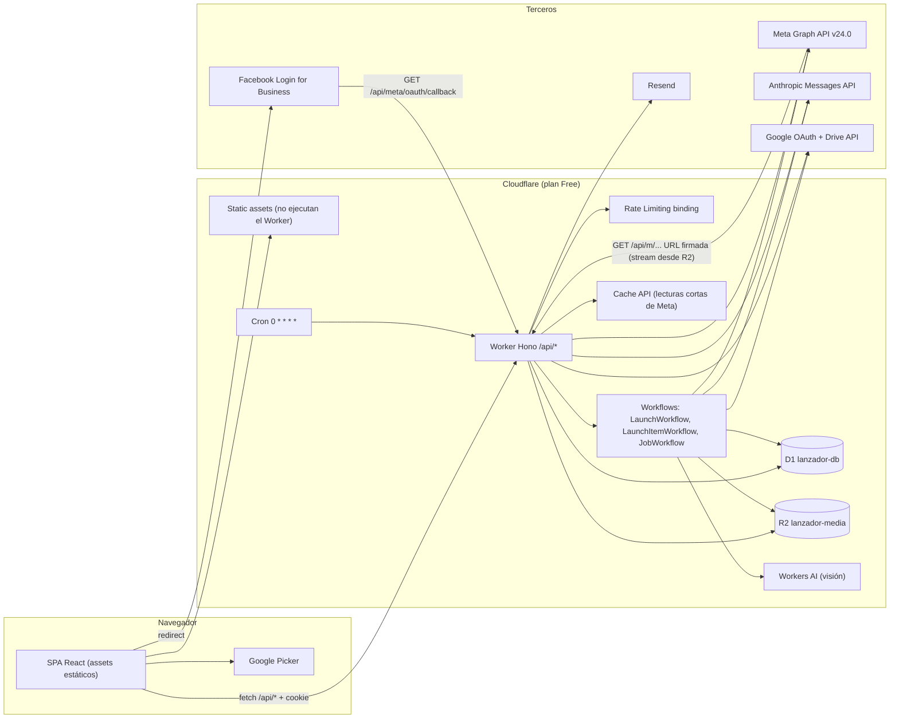

# TRD — Lanzador de anuncios con IA

Fecha: 2026-11-16. Fuentes: `00-brief.md`, `01-PRD.md`, `legacy/inventario-app-vieja.md` (en adelante "inventario"). El schema de datos está en `05-backend-schema.md`.

## 1. Stack elegido

| Capa | Elección | Por qué |
|---|---|---|
| Hosting | Cloudflare Workers plan Free, `lanzador.<subdominio>.workers.dev` | Decisión del brief. Cero costo fijo, escala beta (≤ 20 workspaces, 10 concurrentes) entra en el free tier. Sin dominio propio. |
| Front | React + Vite (SPA), servida como Workers static assets con `assets.run_worker_first: false` y `not_found_handling: "single-page-application"` | Los assets no ejecutan el Worker: no gastan requests de la cuota diaria compartida. No hace falta SSR (todo detrás de login). |
| API | Hono en el mismo Worker, solo bajo `/api/*` | Router liviano, middlewares listos (`secure-headers`, `cors`), tipado end-to-end. Un Worker por app (regla de cuotas). |
| DB | D1 (SQLite) + Drizzle ORM + drizzle-kit | Relacional, transacciones por `batch`, gratis. Drizzle genera SQL tipado y migraciones versionadas. |
| Archivos | R2 bucket `lanzador-media` (privado) | Creativos grandes, egress gratis, multipart desde el Worker con el binding (sin credenciales S3). |
| Trabajos largos | Cloudflare Workflows (3 clases) | Pasos durables con reintento, `step.sleep` sin consumir CPU mientras Meta procesa video (hasta ~15 min), estado persistido. Reemplaza los jobs en memoria de la app vieja. |
| Programación | 1 Cron Trigger `0 * * * *` | Piloto cada 6 h, precalentado de insights y limpieza. Una sola expresión porque las cron del plan Free se comparten en la cuenta. |
| Rate limit | Workers Rate Limiting binding | Por IP y por usuario sin escribir en KV ni D1. |
| IA barata | Workers AI (modelo de visión) | Etiquetado de frames de creativos dentro del cupo diario de neurons. |
| IA de calidad | Claude API (`fetch` a `api.anthropic.com`), `claude-sonnet-5-5` y `claude-haiku-5-5` | Copys en rioplatense, explicaciones del piloto, chat con tool use. |
| Email | Resend (plan gratis) | Magic links e invitaciones. API HTTP simple. |
| Validación | Zod, schemas en `src/shared/` usados por front y back | Una sola definición por contrato. El servidor valida siempre. |
| Tests | Vitest + `@cloudflare/vitest-pool-workers` (unit e integración contra D1/R2 locales de workerd), Playwright E2E | Corre en el runtime real. E2E contra la URL desplegada (criterio del brief). |
| Lenguaje | TypeScript `strict` en todo | Tipos compartidos front/back. |

### Alternativas descartadas

| Alternativa | Por qué no |
|---|---|
| Vercel + Neon/Supabase | El brief fija Cloudflare; Supabase daría RLS real, pero suma otro proveedor y otra cuota. D1 + helper de tenancy + tests alcanza para la escala beta. |
| Postgres vía Hyperdrive | No se necesitan joins pesados ni > 500 MB por base en beta. |
| Queues en lugar de Workflows | Queues no tiene `sleep` durable ni estado por paso; el lanzamiento necesita esperar el procesamiento de video y reintentar pasos sueltos. |
| Durable Objects para jobs | Más código propio (alarmas, estado). Workflows ya resuelve pasos y reintentos. |
| Subida directa navegador → R2 con URLs prefirmadas S3 | Requiere crear credenciales S3 de R2 y guardarlas como secreto. El proxy por partes en el Worker no consume CPU (stream) y respeta el límite de 100 MB por request con partes de 10 MiB. |
| SSE / WebSocket para el progreso | Una conexión abierta por pestaña y un loop de lecturas a D1 dentro del Worker. Polling acotado (≥ 3 s solo mientras corre un lanzamiento) es más simple y barato. |
| Better Auth / Lucia | Solo hace falta magic link + sesión opaca; una implementación propia de ~200 líneas sobre D1 es más chica que adaptar una librería, y queda testeada. |
| Scope `drive.readonly` de Google | Es restringido: para un SaaS exige evaluación de seguridad CASA paga. `drive.file` + Google Picker no la exige. |
| KV para sesiones o cache de insights | Tope de 1.000 escrituras/día. Sesiones e insights van a D1; caches cortas de lecturas de Meta van a la Cache API. |
| Token de usuario de larga duración (60 días) de Meta | Vence y obliga a reconectar. El token de usuario del sistema de la integración de negocio (FLfB) no vence. Queda como camino de respaldo. |

## 2. Arquitectura

### Capas del código

| Carpeta | Responsabilidad | Regla |
|---|---|---|
| `src/api/routes/` | Request/response, Zod, DTO de salida | Sin lógica ni acceso a DB. |
| `src/api/middleware/` | request id, headers, CSRF, rate limit, sesión, workspace+rol | Orden fijo, ver 4.1. |
| `src/api/services/` | Lógica de negocio (lanzador, piloto, métricas, IA) | No conoce HTTP. |
| `src/api/repositories/` | Único lugar que importa tablas de Drizzle; helper de tenancy | Una query (o un `db.batch`) por caso de uso. |
| `src/api/integrations/meta/` | `read.ts` (GET/batch de lectura) y `write.ts` (creaciones y cambios de estado) | `write.ts` solo acepta `status=PAUSED` en edges de creación y `ACTIVE`/`PAUSED` en updates; no existe DELETE. |
| `src/api/integrations/{anthropic,workers-ai,resend,google}/` | Clientes HTTP con timeout y reintentos | |
| `src/workflows/` | `LaunchWorkflow`, `LaunchItemWorkflow`, `JobWorkflow` | Llaman a services. |
| `src/shared/` | Schemas Zod, tipos, constantes (roles, CTA, límites de caracteres, precios de IA) | Importado por front y back. |
| `src/web/` | Páginas, componentes, hooks | Textos en `src/web/i18n/es-AR.ts`. |

Regla ESLint (`no-restricted-imports`): `src/api/services/chat/**` y `src/api/services/ai/**` no pueden importar `integrations/meta/write`. Así el chat y la IA no tienen camino de código hacia una escritura en Meta.

## 3. Herramientas

| Tema | Herramienta |
|---|---|
| Lenguaje | TypeScript 5 `strict`, ESM |
| Framework | Hono (API), React 19 + Vite + React Router (SPA), TanStack Query (fetch, cache, refetch al foco) |
| ORM / migraciones | Drizzle ORM + drizzle-kit (`db:generate`), `wrangler d1 migrations apply` (`db:migrate`) |
| Validación | Zod (schemas compartidos en `src/shared/schemas/`) |
| Tests | Vitest + `@cloudflare/vitest-pool-workers`; Playwright E2E contra el deploy; k6 solo local |
| Lint/format | ESLint (typescript-eslint, react-hooks, jsx-a11y) + Prettier + `tsc --noEmit` |
| CI | GitHub Actions: lint, typecheck, test, build en cada push y PR a `dev`/`main` |
| Deploy | `npx wrangler deploy` (Worker `lanzador`); preview como Worker `lanzador-preview` con su propia D1 y R2 |

## 4. APIs internas

### 4.1 Convenciones comunes

| Tema | Regla |
|---|---|
| Base | Todo bajo `/api`. Rutas de workspace: `/api/w/:wid/...`. |
| Middleware (orden) | `requestId` → `secureHeaders` → `rateLimit(IP)` → `csrf` (mutaciones) → `session` → `rateLimit(usuario)` → `workspace` (membresía + estado del workspace) → `requireRole(min)` → handler. |
| Sesión | Cookie `__Host-lanzador_sid` (`HttpOnly; Secure; SameSite=Lax; Path=/`). Sin sesión: 401. |
| CSRF | `POST/PUT/PATCH/DELETE` exigen `Origin` igual a `APP_ORIGIN` y header `X-Lanzador: 1`. Exentos: `/api/meta/deauthorize`, `/api/meta/data-deletion` (validan `signed_request`). |
| Workspace | Si el usuario no es miembro de `:wid` o un id pedido no pertenece a `:wid`: **404** (nunca 403, para no revelar existencia). Miembro con rol insuficiente: 403 `FORBIDDEN_ROLE`. Workspace desactivado por superadmin: 403 `WORKSPACE_DISABLED`. |
| Roles | Jerarquía `viewer < editor < admin < owner`. La columna "Rol" indica el mínimo. `superadmin` es global y solo accede a `/api/admin/*` (no ve contenido de workspaces de los que no es miembro). |
| Errores | `{"error":{"code":"...","message":"texto para mostrar","requestId":"...","fields":{...}}}`. Sin stack traces. |
| Errores comunes (no se repiten en la tabla) | 400 `VALIDATION`, 401 `UNAUTHENTICATED`, 403 `CSRF_FAILED`, 403 `FORBIDDEN_ROLE`, 404 `NOT_FOUND`, 429 `RATE_LIMITED` (con `Retry-After`), 500 `INTERNAL`. |
| Paginación | Cursor: `?cursor=<opaco>&limit=` (default 25, máximo 100). Respuesta `{data:[...], nextCursor:string|null}`. Sin totales (`COUNT(*)` prohibido por request). |
| DTOs | Explícitos por endpoint. Nunca salen: `token_*`, `*_ciphertext`, `*_hash`, `refresh_token`, ids de sesión. |
| Montos | Enteros en unidades menores (`*Minor`, centavos) + `currency`. |
| Fechas | ISO 8601 UTC en JSON; la UI muestra en la zona del workspace (default `America/Argentina/Buenos_Aires`). |

Rate limits (binding, período 60 s): `IP` 300/min por IP en todo `/api/*`; `USR` 120/min por usuario autenticado; `AUTH` 5/min por IP; `EXP` 10/min por usuario (IA, chequeo de landing, CSV, simulación); `UPL` 600/min por usuario (partes de subida); `MEDIA` 120/min por IP (URL firmada); `POLL` 30/min por usuario (progreso). Los topes de ventanas largas (5 links por email en 15 min, 1 refresco de métricas por minuto por workspace, 1 corrida del piloto cada 5 min) se calculan contra D1 con índice.

### 4.2 Contratos compartidos clave (`src/shared/schemas/`)

| Schema | Forma |
|---|---|
| `LaunchDraft` | `{adAccountAssetId, pixelId, pageId, instagramUserId?, mode:"new_cbo"\|"existing_cbo", existingCampaignId?, productId, copy:{copyId?, primaryText, headline, description, cta}, items:[{source:"upload"\|"drive"\|"clone", creativeId?, cloneAdId?, cloneStoryId?, adName, copyId?}], dailyBudgetMinor?, bidStrategy:"LOWEST_COST_WITHOUT_CAP"\|"COST_CAP", bidAmountMinor?, countries:string[2-letter][], optimizationEvent:"PURCHASE", campaignName, adsetName, driveFolderHint?}` (1 a `plan.max_creatives_per_launch` items; no mezcla video e imagen en un mismo conjunto, igual que la app vieja). |
| `LaunchPlan` | `{campaign?, adset, ads:[{position, adName, mediaKind, link, pageId, instagramUserId}], warnings:[{code,text}], blockers:[{code,text}], planHash}` |
| `LaunchProgress` | `{status, phase, counts:{total,done,failed}, items:[{id, position, status, adName, metaAdId?, error?}], checks?:[{ok, code, text}], updatedAt, nextPollMs:number\|null}` |
| `Proposal` | `{id, action:"pause"\|"scale"\|"duplicate", object:{level, id, name, adAccountId}, evidence:{spendMinor, purchases, roas, cpaMinor, breakEvenRoas?, window}, currentBudgetMinor?, proposedBudgetMinor?, percent?, explanation, status}` |
| `MetricsRow` | `{id, name, level, status, adAccountId, currency, productId?, dailyBudgetMinor?, spendMinor, purchases, purchaseValueMinor, roas, cpaMinor, ctr, cpmMinor, protected, scaledHoursAgo?}` |

### 4.3 Tabla de endpoints

Leyenda de auth: `pub` público · `ses` sesión · `ses+ws` sesión + membresía · `sig` firma Meta (`signed_request`) · `hmac` URL firmada · `state` state OAuth de un uso + sesión.

#### Auth, sesión y workspaces (F1)

| F | Método | Ruta | Auth | Rol | Request | Response | Errores | Rate limit | Pag. |
|---|---|---|---|---|---|---|---|---|---|
| F1 | POST | `/api/auth/magic-link` | pub | — | `{email}` | 202 `{ok:true}` siempre (no revela si existe) | 503 `EMAIL_SEND_FAILED` | AUTH + 5 por email / 15 min (D1) → 429 | no |
| F1 | POST | `/api/auth/verify` | pub | — | `{token}` (viene del fragmento `#t=` de `/ingresar/confirmar`) | 200 `{user, workspaces}` + `Set-Cookie` | 410 `LINK_EXPIRED` (usado o vencido) | AUTH | no |
| F1 | POST | `/api/auth/logout` | ses | — | — | 204 + cookie expirada | — | USR | no |
| F1 | GET | `/api/me` | ses | — | — | `{user:{id,email,name,isSuperadmin}, workspaces:[{id,name,role,status}]}` | — | USR | no |
| F1 | POST | `/api/workspaces` | ses | — | `{name}` | 201 `{workspace, role:"owner"}` | 403 `BETA_INVITE_REQUIRED`, 422 `WORKSPACE_LIMIT` (3 por usuario) | USR | no |
| F1 | GET | `/api/w/:wid` | ses+ws | viewer | — | `{workspace, role, plan:{limits}, settings}` | — | USR | no |
| F1 | PATCH | `/api/w/:wid` | ses+ws | admin | `{name}` | `{workspace}` | — | USR | no |
| F1 | DELETE | `/api/w/:wid` | ses+ws | owner | `{confirmName}` | 202 `{purgeAfter}` (borrado lógico, purga a los 7 días) | 422 `CONFIRM_MISMATCH` | USR | no |
| F1 | GET | `/api/w/:wid/settings` | ses+ws | viewer | — | `{maxCampaignBudgetMinor, budgetCurrency, maxScalePercent, advantageCreativeEnabled, timezone, defaultCountries, nameTemplates, launchDefaults}` | — | USR | no |
| F1 | PATCH | `/api/w/:wid/settings` | ses+ws | admin | parcial del anterior | `{settings}` | 422 `SCALE_PERCENT_MAX_50` | USR | no |
| F1 | GET | `/api/w/:wid/members` | ses+ws | viewer | `?cursor&limit` | `{data:[{userId,email,name,role,joinedAt}]}` | — | USR | sí |
| F1 | PATCH | `/api/w/:wid/members/:userId` | ses+ws | admin | `{role:"admin"\|"editor"\|"viewer"}` | `{member}` | 422 `CANNOT_CHANGE_OWNER` | USR | no |
| F1 | DELETE | `/api/w/:wid/members/:userId` | ses+ws | admin (o uno mismo) | — | 204 | 422 `OWNER_CANNOT_LEAVE` | USR | no |
| F1 | POST | `/api/w/:wid/transfer-ownership` | ses+ws | owner | `{userId, confirm:true}` | `{workspace}` (el owner viejo pasa a admin) | 422 `NOT_A_MEMBER` | USR | no |
| F1 | GET | `/api/w/:wid/invitations` | ses+ws | admin | `?cursor&limit` | `{data:[{id,email,role,expiresAt,status}]}` | — | USR | sí |
| F1 | POST | `/api/w/:wid/invitations` | ses+ws | admin | `{email, role}` (no `owner`) | 201 `{invitation}` + email | 409 `ALREADY_MEMBER`, 409 `INVITATION_PENDING`, 422 `PLAN_MEMBER_LIMIT`, 503 `EMAIL_SEND_FAILED` | USR + EXP | no |
| F1 | DELETE | `/api/w/:wid/invitations/:id` | ses+ws | admin | — | 204 (revoca) | — | USR | no |
| F1 | POST | `/api/invitations/accept` | pub o ses | — | `{token}` | 200 `{workspaceId, role}` + `Set-Cookie` si no había sesión | 410 `INVITATION_EXPIRED`, 409 `EMAIL_MISMATCH` | AUTH | no |
| F1 | POST | `/api/test/magic-link` | header `X-E2E-Secret` | — | `{email}` | `{link}` | 404 en producción (la ruta no se registra) | AUTH | no |

#### Superadmin (F1, F5, F10)

| F | Método | Ruta | Auth | Rol | Request | Response | Errores | Rate limit | Pag. |
|---|---|---|---|---|---|---|---|---|---|
| F1 | GET | `/api/admin/workspaces` | ses | superadmin | `?status&cursor&limit` | `{data:[{id,name,status,planId,ownerEmail,metaStatus,createdAt,aiCostMonthMicrousd}]}` | — | USR | sí |
| F1 | PATCH | `/api/admin/workspaces/:id` | ses | superadmin | `{status?:"active"\|"disabled", disabledReason?, planId?, aiBudgetOverrideMicrousd?}` | `{workspace}` | — | USR | no |
| F1 | GET | `/api/admin/beta-invites` | ses | superadmin | `?cursor&limit` | `{data:[{id,email,note,usedAt,revokedAt}]}` | — | USR | sí |
| F1 | POST | `/api/admin/beta-invites` | ses | superadmin | `{email, note?}` | 201 `{invite}` + email de bienvenida | 409 `ALREADY_INVITED` | USR | no |
| F1 | DELETE | `/api/admin/beta-invites/:id` | ses | superadmin | — | 204 (revoca, no borra) | — | USR | no |
| F5 | GET | `/api/admin/usage` | ses | superadmin | `?month=YYYY-MM` | `{workspaces:[{id,name,aiCostMicrousd,claudeInputTokens,claudeOutputTokens,neurons,metaCalls}], global:{neuronsToday, storageBytes}}` | — | USR | no |
| F10 | GET | `/api/admin/errors` | ses | superadmin | `?source&cursor&limit` | `{data:[{id,source,route,status,code,message,workspaceId,requestId,createdAt}]}` | — | USR | sí |

#### Meta: conexión, activos y callbacks (F2)

| F | Método | Ruta | Auth | Rol | Request | Response | Errores | Rate limit | Pag. |
|---|---|---|---|---|---|---|---|---|---|
| F2 | POST | `/api/w/:wid/meta/connect` | ses+ws | admin | — | `{authorizeUrl}` (FLfB con `config_id` y `state`) | — | USR | no |
| F2 | GET | `/api/meta/oauth/callback` | state | admin | `?code&state` o `?error` | 302 a `/ajustes/meta?resultado=ok` o `?resultado=error&motivo=<code>` | motivos: `STATE_INVALID`, `META_DENIED`, `TOKEN_EXCHANGE_FAILED`, `MISSING_PERMISSIONS` | AUTH | no |
| F2 | GET | `/api/w/:wid/meta/connections` | ses+ws | viewer | — | `{data:[{id,businessId,businessName,status,scopes,connectedBy,connectedAt,lastErrorCode}]}` | — | USR | no |
| F2 | GET | `/api/w/:wid/meta/assets` | ses+ws | viewer | `?kind&enabled&cursor&limit` | `{data:[{id,kind,metaId,name,parentMetaId,currency,enabled,health}]}` | — | USR | sí |
| F2 | PATCH | `/api/w/:wid/meta/assets` | ses+ws | admin | `{changes:[{id, enabled}]}` (máx. 100) | `{data:[asset]}` | 422 `PLAN_AD_ACCOUNT_LIMIT` | USR | no |
| F2 | POST | `/api/w/:wid/meta/connections/:id/refresh-assets` | ses+ws | admin | — | `{data:[asset]}` | 409 `META_RECONNECT_REQUIRED`, 502 `META_ERROR` | EXP | no |
| F2 | DELETE | `/api/w/:wid/meta/connections/:id` | ses+ws | admin | `{confirm:true}` | 204 (revoca en Meta, borra token y activos) | — | USR | no |
| F2 | POST | `/api/meta/deauthorize` | sig | — | form `signed_request` | 200 | 400 `BAD_SIGNATURE` | IP | no |
| F2 | POST | `/api/meta/data-deletion` | sig | — | form `signed_request` | `{url, confirmation_code}` | 400 `BAD_SIGNATURE` | IP | no |
| F2 | GET | `/api/meta/data-deletion/:code` | pub | — | — | `{status:"received"\|"done", receivedAt, completedAt}` | — | AUTH | no |
| F4 | GET | `/api/w/:wid/meta/ad-accounts/:assetId/campaigns` | ses+ws | viewer | `?status=ACTIVE,PAUSED` | `{data:[{id,name,effectiveStatus,dailyBudgetMinor,objective,bidStrategy,isCbo}]}` (Cache API 60 s) | 409 `META_RECONNECT_REQUIRED`, 502 `META_ERROR` | USR | no (tope 300, como la app vieja, con aviso si se trunca) |
| F4 | GET | `/api/w/:wid/meta/campaigns/:campaignId/reference` | ses+ws | editor | `?adAccountAssetId` | `{adsetName, optimizationGoal, customEventType, pixelId, bidStrategy, bidAmountMinor, countries, dailyBudgetMinor, nextAdsetNumber}` | 422 `NO_REFERENCE_ADSET`, 422 `NOT_CBO` | USR | no |
| F4 | GET | `/api/w/:wid/meta/campaigns/:campaignId/ads` | ses+ws | editor | `?adAccountAssetId&range` | `{data:[{adId,name,storyId,thumbnailUrl,effectiveStatus,spendMinor,purchases,roas}]}` | 502 `META_ERROR` | USR | no (tope 200) |
| F4 | GET | `/api/w/:wid/meta/ads/:adId/preview` | ses+ws | viewer | `?adAccountAssetId` | `{iframeSrc}` (solo host `facebook.com`, nunca HTML crudo) | 502 `META_ERROR` | USR | no |

Toda ruta con `adAccountAssetId` valida que el activo pertenece a `:wid`, está habilitado y que el objeto de Meta pedido tiene ese `account_id` (si no: 404).

#### Productos y copys (F3, F5)

| F | Método | Ruta | Auth | Rol | Request | Response | Errores | Rate limit | Pag. |
|---|---|---|---|---|---|---|---|---|---|
| F3 | GET | `/api/w/:wid/products` | ses+ws | viewer | `?q&archived&cursor&limit` | `{data:[{id,name,landingUrl,headline,primaryText,cta,landingStatus,breakEvenRoas,archived}]}` | — | USR | sí |
| F3 | POST | `/api/w/:wid/products` | ses+ws | editor | `{name, landingUrl, primaryText, headline, description?, cta, utm?, priceMinor?, costMinor?, currency}` | 201 `{product}` | 409 `NAME_TAKEN`, 422 `COST_NOT_BELOW_PRICE`, 422 `LANDING_NOT_HTTPS` | USR | no |
| F3 | GET | `/api/w/:wid/products/:id` | ses+ws | viewer | — | `{product}` con `breakEvenRoas` y `profitPerSaleMinor` calculados | — | USR | no |
| F3 | PATCH | `/api/w/:wid/products/:id` | ses+ws | editor | parcial | `{product}` (cambiar la URL vuelve `landingStatus` a `unchecked`) | 409 `NAME_TAKEN` | USR | no |
| F3 | POST | `/api/w/:wid/products/:id/duplicate` | ses+ws | editor | — | 201 `{product}` (nombre + " (copia)") | — | USR | no |
| F3 | POST | `/api/w/:wid/products/:id/archive` | ses+ws | editor | `{archived:boolean}` | `{product}` | — | USR | no |
| F3 | POST | `/api/w/:wid/products/:id/check-landing` | ses+ws | editor | — | `{status:"ok"\|"soft_ok"\|"error", httpStatus, finalUrl, ms, error?}` | — | EXP | no |
| F5 | POST | `/api/w/:wid/products/:id/copies/generate` | ses+ws | editor | `{angle:"dolor"\|"beneficio"\|"prueba_social"\|"oferta"\|"urgencia"\|"libre", customAngle?}` | `{data:[5 copies con policyRisk]}` | 422 `AI_BUDGET_EXHAUSTED`, 502 `AI_UPSTREAM` | EXP | no |
| F5 | GET | `/api/w/:wid/products/:id/copies` | ses+ws | viewer | `?status&favorite&cursor&limit` | `{data:[copy]}` | — | USR | sí |
| F5 | POST | `/api/w/:wid/products/:id/copies` | ses+ws | editor | `{primaryText, headline, description?}` (copy manual) | 201 `{copy}` | — | USR | no |
| F5 | PATCH | `/api/w/:wid/copies/:copyId` | ses+ws | editor | `{primaryText?, headline?, description?, favorite?, status?:"saved"\|"discarded"}` | `{copy}` | — | USR | no |

#### Creativos, subidas y Drive (F4, F6)

| F | Método | Ruta | Auth | Rol | Request | Response | Errores | Rate limit | Pag. |
|---|---|---|---|---|---|---|---|---|---|
| F4 | POST | `/api/w/:wid/uploads` | ses+ws | editor | `{fileName, contentType, sizeBytes, sha256?}` | 201 `{uploadId, creativeId, partSizeBytes:10485760, partCount, duplicateOf?}` | 413 `FILE_TOO_LARGE` (video 500 MB, imagen 30 MB), 415 `UNSUPPORTED_TYPE` (mp4, mov, m4v, jpg, png), 422 `STORAGE_QUOTA_EXCEEDED` | USR | no |
| F4 | PUT | `/api/w/:wid/uploads/:uploadId/parts/:partNumber` | ses+ws | editor | cuerpo binario, `Content-Length` = tamaño de parte (la última puede ser menor) | `{partNumber, etag}` | 400 `BAD_PART_SIZE`, 409 `UPLOAD_NOT_ACTIVE` | UPL | no |
| F4 | POST | `/api/w/:wid/uploads/:uploadId/complete` | ses+ws | editor | — | `{creative}` | 409 `PARTS_MISSING` | USR | no |
| F4 | POST | `/api/w/:wid/uploads/:uploadId/abort` | ses+ws | editor | — | 204 | — | USR | no |
| F6 | PUT | `/api/w/:wid/creatives/:id/frames/:idx` | ses+ws | editor | `image/jpeg` ≤ 300 KB, `idx` 0–2, header `X-Frame-Time-Ms` | 204 (al completar los frames encola el etiquetado) | 413, 415 | UPL | no |
| F4 | GET | `/api/w/:wid/creatives` | ses+ws | viewer | `?status&kind&q&ids&cursor&limit` | `{data:[{id,kind,status,aiStatus,adName,tags,frameUrls,sizeBytes,storageState}]}` | — | USR | sí |
| F6 | GET | `/api/w/:wid/creatives/:id` | ses+ws | viewer | — | `{creative, frames, tags, metaMedia:[{adAccountId,status}]}` | — | USR | no |
| F4 | GET | `/api/w/:wid/creatives/:id/media` | ses+ws | viewer | `?variant=original\|frame-0\|frame-1\|frame-2`, soporta `Range` | stream desde R2 | 410 `MEDIA_PURGED` | USR | no |
| F6 | PATCH | `/api/w/:wid/creatives/:id` | ses+ws | editor | `{adName?, tags?:{hook,angle,format,language,onScreenText}}` | `{creative}` | — | USR | no |
| F6 | POST | `/api/w/:wid/creatives/:id/retag` | ses+ws | editor | — | 202 `{aiStatus:"queued"}` | 422 `AI_BUDGET_EXHAUSTED`, 409 `FRAMES_MISSING` | EXP | no |
| F4 | POST | `/api/w/:wid/creatives/:id/archive` | ses+ws | editor | `{archived:boolean}` | `{creative}` | — | USR | no |
| F4 | GET | `/api/m/:creativeId/:exp/:sig` | hmac | — | `HEAD`/`GET`, soporta `Range` | stream del original desde R2 (`Content-Type`, `Content-Length`, `Accept-Ranges`) | 403 `BAD_SIGNATURE`, 410 `URL_EXPIRED`, 404 | MEDIA | no |
| F4 | POST | `/api/w/:wid/google/connect` | ses+ws | editor | — | `{authorizeUrl}` (scopes `drive.file openid email`) | — | USR | no |
| F4 | GET | `/api/google/oauth/callback` | state | editor | `?code&state` o `?error` | 302 a `/lanzar?google=ok\|error` | `STATE_INVALID`, `TOKEN_EXCHANGE_FAILED` | AUTH | no |
| F4 | GET | `/api/w/:wid/google/connection` | ses+ws | editor | — | `{connected, email, status}` (de la conexión del usuario actual) | — | USR | no |
| F4 | GET | `/api/w/:wid/google/picker-token` | ses+ws | editor | — | `{accessToken, expiresAt, apiKey, appId}` (token corto, solo `drive.file`) | 409 `GOOGLE_RECONNECT_REQUIRED` | USR | no |
| F4 | DELETE | `/api/w/:wid/google/connection` | ses+ws | editor | — | 204 (revoca en Google y borra) | — | USR | no |
| F4 | POST | `/api/w/:wid/google/imports` | ses+ws | editor | `{files:[{id,name,mimeType,sizeBytes}]}` (máx. 30, elegidos en el Picker) | 202 `{data:[{creativeId,status:"importing"}]}` | 413, 415, 422 `STORAGE_QUOTA_EXCEEDED`, 409 `GOOGLE_RECONNECT_REQUIRED` | EXP | no |

#### Lanzamientos e historial (F4, F9, F10)

| F | Método | Ruta | Auth | Rol | Request | Response | Errores | Rate limit | Pag. |
|---|---|---|---|---|---|---|---|---|---|
| F4 | POST | `/api/w/:wid/launches` | ses+ws | editor | `{draft: LaunchDraft parcial}` | 201 `{launch}` (`status:"draft"`) | — | USR | no |
| F10 | GET | `/api/w/:wid/launches` | ses+ws | viewer | `?status&cursor&limit` | `{data:[{id,status,source,productName,adAccountName,campaignName,itemsTotal,itemsDone,itemsFailed,metaCampaignUrl,createdBy,createdAt}]}` | — | USR | sí |
| F10 | GET | `/api/w/:wid/launches/:id` | ses+ws | viewer | — | `{launch, items, checks, plan}` | — | USR | no |
| F4 | PATCH | `/api/w/:wid/launches/:id` | ses+ws | editor | `{draft}` | `{launch}` (vuelve a `draft` si estaba `simulated`) | 409 `NOT_EDITABLE` | USR | no |
| F4 | POST | `/api/w/:wid/launches/:id/simulate` | ses+ws | editor | — | `LaunchPlan` (solo lecturas en Meta) | 409 `META_RECONNECT_REQUIRED`, 502 `META_ERROR` | EXP | no |
| F4 | POST | `/api/w/:wid/launches/:id/start` | ses+ws | editor | `{confirm:true, planHash}` | 202 `{status:"queued"}` | 409 `NOT_SIMULATED`, 409 `PLAN_CHANGED`, 422 `BLOCKERS` (tope de presupuesto, landing en error, cuenta no activa o no USD, creativos sin terminar), 409 `META_RECONNECT_REQUIRED` | USR | no |
| F4 | GET | `/api/w/:wid/launches/:id/progress` | ses+ws | viewer | `?since=<updatedAt>` | `LaunchProgress` (solo ítems cambiados desde `since`) | — | POLL | no |
| F4 | POST | `/api/w/:wid/launches/:id/retry-failed` | ses+ws | editor | `{confirm:true}` | 202 | 409 `NOTHING_TO_RETRY`, 409 `LAUNCH_RUNNING` | USR | no |
| F4 | POST | `/api/w/:wid/launches/:id/verify` | ses+ws | editor | — | 202 | 409 `LAUNCH_RUNNING` | USR | no |
| F4, F10 | POST | `/api/w/:wid/launches/:id/activate` | ses+ws | editor | `{confirm:true, startAt?}` (`startAt` = "Programar") | 202 `{status:"activating"}` | 409 `CHECKS_NOT_GREEN`, 422 `START_IN_PAST`, 409 `NOT_PAUSED` | USR | no |
| F4 | POST | `/api/w/:wid/launches/:id/discard` | ses+ws | editor | — | 204 (solo `draft`/`simulated`; no toca Meta) | 409 `NOT_EDITABLE` | USR | no |

#### Métricas, Hoy y acciones manuales (F6, F7)

| F | Método | Ruta | Auth | Rol | Request | Response | Errores | Rate limit | Pag. |
|---|---|---|---|---|---|---|---|---|---|
| F7 | GET | `/api/w/:wid/today` | ses+ws | viewer | — | `{accounts:[{id,name,currency,spendTodayMinor,spendYesterdayMinor,purchases,roas,cpaMinor}], alerts:[{kind,severity,text,objectId}], proposals:{pendingCount, top:[Proposal x5]}, launches:[x5], updatedAt, stale}` | — | USR | no |
| F7 | GET | `/api/w/:wid/metrics` | ses+ws | viewer | `?level=account\|campaign\|adset\|ad&range=today\|yesterday\|last_7d\|last_14d\|last_30d\|this_month\|custom&from&to&adAccountIds&productId&status&q&sort&cursor&limit` | `{data:[MetricsRow], totals, previousTotals, daily?, updatedAt, stale, nextCursor}` | 422 `RANGE_INVALID` (máx. 400 días, no futuro) | USR | sí |
| F7 | GET | `/api/w/:wid/metrics/export.csv` | ses+ws | viewer | mismos filtros | `text/csv` (máx. 5.000 filas, escape de fórmulas `= + - @`) | 422 `RANGE_INVALID` | EXP | no |
| F7 | GET | `/api/w/:wid/metrics/top-ads` | ses+ws | viewer | `?range&minSpendMinor=1000&limit=16` | `{data:[{adId,name,adAccountId,storyId,thumbnailUrl,spendMinor,roas,purchases}]}` | — | USR | no |
| F6 | GET | `/api/w/:wid/metrics/winning-tags` | ses+ws | viewer | `?range&dimension=hook\|angle\|format\|language\|onScreenText` | `{data:[{tag, ads, spendMinor, purchases, roas, cpaMinor}]}` | — | USR | no |
| F7 | POST | `/api/w/:wid/metrics/refresh` | ses+ws | viewer | `{range?}` | `{updatedAt}` | 429 si hubo refresco hace < 60 s | USR | no |
| F7 | POST | `/api/w/:wid/meta/objects/:objectId/status` | ses+ws | editor | `{adAccountAssetId, level:"campaign"\|"adset"\|"ad", status:"ACTIVE"\|"PAUSED", confirm:true}` | `{status}` | 422 `INVALID_STATUS`, 409 `META_RECONNECT_REQUIRED`, 502 `META_ERROR` | USR | no |
| F7 | POST | `/api/w/:wid/meta/campaigns/:campaignId/scale` | ses+ws | editor | `{adAccountAssetId, percent (1–50), expectedCurrentBudgetMinor, confirm:true}` | `{previousBudgetMinor, newBudgetMinor}` | 409 `BUDGET_CHANGED`, 422 `SCALE_LIMIT`, 422 `BUDGET_CAP`, 422 `NOT_CBO`, 502 `META_ERROR` | USR | no |
| F8 | GET | `/api/w/:wid/protected-campaigns` | ses+ws | viewer | `?cursor&limit` | `{data:[{campaignId, adAccountId, protectedBy, createdAt}]}` | — | USR | sí |
| F8 | PUT | `/api/w/:wid/protected-campaigns/:campaignId` | ses+ws | editor | `{adAccountAssetId}` | 204 | — | USR | no |
| F8 | DELETE | `/api/w/:wid/protected-campaigns/:campaignId` | ses+ws | editor | — | 204 | — | USR | no |

#### Piloto (F8)

| F | Método | Ruta | Auth | Rol | Request | Response | Errores | Rate limit | Pag. |
|---|---|---|---|---|---|---|---|---|---|
| F8 | GET | `/api/w/:wid/pilot/rules` | ses+ws | viewer | — | `{data:[{ruleType, enabled, params}]}` | — | USR | no |
| F8 | PUT | `/api/w/:wid/pilot/rules` | ses+ws | admin | `{rules:[{ruleType, enabled, params}]}` | `{data}` | 422 `SCALE_PERCENT_MAX_50` | USR | no |
| F8 | POST | `/api/w/:wid/pilot/run` | ses+ws | editor | — | 200 `{run, proposals}` (síncrono, usa insights con ≤ 15 min) | 409 `RUN_IN_PROGRESS`, 429 si corrió hace < 5 min, 422 `AI_BUDGET_EXHAUSTED` (las propuestas salen igual, sin explicación) | EXP | no |
| F8 | GET | `/api/w/:wid/pilot/runs` | ses+ws | viewer | `?cursor&limit` | `{data:[{id,trigger,status,proposalsCreated,startedAt,finishedAt}]}` | — | USR | sí |
| F8 | GET | `/api/w/:wid/pilot/proposals` | ses+ws | viewer | `?status=pending&cursor&limit` | `{data:[Proposal]}` | — | USR | sí |
| F8 | POST | `/api/w/:wid/pilot/proposals/:id/approve` | ses+ws | editor | `{confirm:true, proposedBudgetMinor?}` (obligatorio y debe coincidir si es `scale`) | `{proposal, launchId?}` (`duplicate` crea un borrador de lanzamiento) | 409 `PROPOSAL_STALE` (ya decidida, vencida o el presupuesto cambió), 422 `BUDGET_CAP`, 502 `META_ERROR` | USR | no |
| F8 | POST | `/api/w/:wid/pilot/proposals/:id/dismiss` | ses+ws | editor | `{reason?}` | `{proposal}` | 409 `PROPOSAL_STALE` | USR | no |

#### Chat, auditoría y varios (F9, F10)

| F | Método | Ruta | Auth | Rol | Request | Response | Errores | Rate limit | Pag. |
|---|---|---|---|---|---|---|---|---|---|
| F9 | POST | `/api/w/:wid/chat/sessions` | ses+ws | editor | — | 201 `{session}` | — | USR | no |
| F9 | GET | `/api/w/:wid/chat/sessions` | ses+ws | editor | `?cursor&limit` (solo las propias) | `{data:[{id,title,status,launchId,updatedAt}]}` | — | USR | sí |
| F9 | GET | `/api/w/:wid/chat/sessions/:id/messages` | ses+ws | editor | `?cursor&limit` | `{data:[{id,role,content,createdAt}]}` (sin mensajes `tool`) | — | USR | sí |
| F9 | POST | `/api/w/:wid/chat/sessions/:id/messages` | ses+ws | editor | `{text}` (≤ 2.000 caracteres) | `{messages:[assistant], draftLaunchId?}` | 422 `AI_BUDGET_EXHAUSTED`, 502 `AI_UPSTREAM`, 409 `SESSION_CLOSED` | EXP | no |
| F10 | GET | `/api/w/:wid/audit` | ses+ws | viewer | `?origin&action&objectId&from&to&cursor&limit` | `{data:[{id,actorEmail,origin,action,objectType,objectId,objectName,result,detail,createdAt}]}` | — | USR | sí |
| — | GET | `/api/health` | pub | — | — | `{ok:true, version}` (no toca D1) | — | IP | no |
| — | POST | `/api/client-errors` | pub (sesión opcional) | — | `{message, stack?, route, release}` | 204 | — | AUTH (20/min) | no |

### 4.4 Polling y tiempo real

| Situación | Intervalo | Cómo se corta |
|---|---|---|
| Lanzamiento en `queued`, `running`, `verifying` o `activating` (incluye la importación de Drive de un borrador abierto en el lanzador) | 3 s (`nextPollMs:3000` lo dicta el servidor) | El servidor devuelve `nextPollMs:null` al llegar a un estado final; el front deja de pedir. |
| Pestaña Hoy y Métricas visibles | 60 s, solo con `document.visibilityState === "visible"`, más refetch al volver el foco | Pestaña oculta: no pide. |
| Corrida del piloto a pedido | Sin polling (síncrona) | — |
| Cualquier otra pantalla | Sin polling | — |

### 4.5 Trabajos en segundo plano (Workflows)

| Clase | Instancia (id determinístico) | Pasos | Reintentos |
|---|---|---|---|
| `LaunchWorkflow` | `launch-<launchId>-<attempt>` | 1 preflight (cuenta, página/IG, landing, referencia si es CBO existente) → 2 crear campaña (si `new_cbo`) → 3 crear conjunto → 4 crear hijos `LaunchItemWorkflow` en tandas de 5 y esperar con `step.sleep(20 s)` + lectura de contadores en D1 → 5 verificación con un `POST /` batch de Graph → 6 marcar `paused_verified` o `verified_with_errors` | Cada paso: 3 intentos ante 5xx/red (10 s, 30 s, 90 s); códigos de límite de Meta usan el backoff de 6.3. Pasos de creación son idempotentes: antes de crear se mira el id guardado en D1 y, en reintento, se busca en Meta por nombre exacto creado después de `started_at`. |
| `LaunchItemWorkflow` | `item-<launchItemId>-<attempt>` | 1 media: imagen → `adimages`; video → `advideos` con `file_url` firmado (fallback resumable) o reusa `creative_meta_media` si ese creativo ya está en esa cuenta → 2 esperar procesamiento (`step.sleep` 10 s, 20 s, 30 s y después 60 s; máx. 20 chequeos ≈ 17 min) → 3 miniatura → 4 creativo → 5 anuncio en `PAUSED` | Igual que arriba. Un ítem fallido no frena a los demás. |
| `JobWorkflow` | `<kind>-<clave>` | `kind` ∈ `activate_launch`, `drive_import_file`, `tag_creative`, `insights_refresh`, `pilot_run`, `purge_workspace`, `meta_disconnect_cleanup` | 3 intentos, sin reintentos infinitos; al agotar se registra en `error_events`. |

Presupuesto de subrequests: cada instancia cuenta sus `fetch` externos y, al llegar a 45, encadena una instancia de continuación con el estado mínimo (offset, ids). Se diseña así porque el plan Free limita a 50 subrequests externos por invocación y se asume el caso más estricto (por instancia).

### 4.6 Cron (`0 * * * *`, UTC)

| Condición | Qué hace |
|---|---|
| Siempre | Limpieza: `magic_links`, `oauth_states` y `sessions` vencidos; `uploads` abandonados (> 24 h, aborta multipart en R2); `insights_cache` vencido hace > 24 h; `error_events` > 30 días; originales de R2 con `purge_after` vencido; propuestas `pending` vencidas → `expired`. |
| Siempre | Precalentado: `JobWorkflow insights_refresh` (rango `today`, niveles cuenta y campaña + salud) para workspaces con una sesión vista en las últimas 2 h. |
| Hora UTC ∈ {0, 6, 12, 18} (AR 21, 3, 9, 15 h) | `JobWorkflow pilot_run` por workspace activo con Meta conectado y al menos una regla habilitada. |
| Hora UTC = 7 | Purga de workspaces en `deleting` con `deleted_at` > 7 días; recálculo de `storage_bytes_used`. |

## 5. Flujos técnicos clave

### 5.1 Subida de creativos desde el navegador

1. El navegador valida tipo y tamaño, calcula `sha256` si el archivo pesa ≤ 200 MB (aviso de duplicado) y llama `POST /uploads`.
2. El Worker crea la fila `creatives` (`uploading`), la fila `uploads` y `createMultipartUpload` en R2 con clave `ws/<wid>/creatives/<creativeId>/original.<ext>`.
3. El navegador sube partes de 10 MiB con `PUT .../parts/:n`, 3 en paralelo, con reintento por parte. El Worker hace `uploadPart(n, request.body)` en stream (sin buffer, sin CPU) y guarda el `etag` en `upload_parts`.
4. `POST .../complete` arma la lista de partes desde D1 y completa en R2. El creativo pasa a `ready` y suma `size_bytes` al uso del workspace.
5. En paralelo, el navegador extrae 3 frames JPEG con `<video>` + `canvas` (0,5 s, 2,5 s y 50 % de la duración; lado mayor 512 px, calidad 0,7) y los sube a `PUT /creatives/:id/frames/:idx`. Para imágenes sube 1 frame redimensionado. Con los frames completos se encola `tag_creative`.
6. Archivos de Drive: el job copia el archivo a R2 en stream (`files/{id}?alt=media` → `R2.put` con `FixedLengthStream`); al terminar, la pantalla del lanzador (o la próxima carga de la biblioteca) baja el original por `/creatives/:id/media` y extrae los frames igual que en el paso 5.

### 5.2 Video hacia Meta

| Orden | Método | Detalle |
|---|---|---|
| Preferido | `POST /{act}/advideos` con `file_url` = `https://<app>/api/m/<creativeId>/<exp>/<sig>` | `sig` = HMAC-SHA256(`MEDIA_URL_SIGNING_KEY`, `"<wid>.<creativeId>.<exp>"`) en base64url; `exp` = ahora + 2 h; comparación en tiempo constante. El Worker devuelve `R2.get(...).body` con soporte de `Range` y `HEAD`. Meta descarga; el Worker no usa CPU. |
| Respaldo (si `file_url` da error) | Subida resumable de la app vieja contra `graph-video.facebook.com`: `upload_phase=start` (`file_size`) → `transfer` en bucle (`upload_session_id`, `start_offset`, parte `video_file_chunk` armada como stream: preámbulo multipart + rango de R2 + cierre) → `finish` (`title`) | Agrupa varias transferencias por paso hasta 5 min de reloj; guarda el `start_offset` en el estado del paso. |
| Después | `GET {video_id}?fields=status` hasta `video_status=ready`; `GET {video_id}/thumbnails` (preferida o primera); `GET {video_id}?fields=format` para el aviso de video horizontal | Igual que inventario 2.4. |

### 5.3 Payloads de Meta (heredados del inventario, sin cambios de semántica)

| Objeto | Llamada | Campos |
|---|---|---|
| Campaña (solo `new_cbo`) | `POST {act}/campaigns` | `name, objective` (default `OUTCOME_SALES`), `status=PAUSED, buying_type=AUCTION, special_ad_categories=[]`, `bid_strategy` (`LOWEST_COST_WITHOUT_CAP` o `COST_CAP`), `daily_budget` (centavos, 1 ≤ presupuesto ≤ tope del workspace). |
| Conjunto | `POST {act}/adsets` | `name, campaign_id, status=PAUSED, optimization_goal` (`OFFSITE_CONVERSIONS`), `billing_event` (`IMPRESSIONS`), `targeting` (pasado por `cleanTargeting`, lista blanca de inventario 2.2), `promoted_object={pixel_id, custom_event_type:"PURCHASE"}`, `attribution_spec`, `start_time?`, `bid_amount?`, `bid_constraints?`. En CBO existente se copian del conjunto más nuevo `optimization_goal, billing_event, attribution_spec, targeting, custom_event_type` y `bid_amount`/`bid_constraints` según `bid_strategy`. |
| Imagen | `POST {act}/adimages` multipart `filename` | Devuelve `images.<nombre>.hash`. |
| Creativo nuevo | `POST {act}/adcreatives` | `object_story_spec={page_id, instagram_user_id?, video_data:{video_id, image_url, title, message, link_description, call_to_action:{type, value:{link}}}}` o `link_data={image_hash, link, name, message, description, call_to_action}`; `degrees_of_freedom_spec.creative_features_spec` = todas las features en `OPT_OUT` sin `standard_enhancements` (salvo que el workspace active mejoras); `contextual_multi_ads={enroll_status:"OPT_OUT"}`; `url_tags` = UTM del producto. |
| Creativo clonado | `POST {act}/adcreatives` | `name, object_story_id` (prefijo = `page_id` elegido, si no: error "publicación de otra página"), mismo `degrees_of_freedom_spec` y `contextual_multi_ads`. |
| Anuncio | `POST {act}/ads` | `name, adset_id, status=PAUSED, creative={creative_id}, tracking_specs=[{"action.type":["offsite_conversion"],"fb_pixel":[pixel]}]`. |
| Activación | `POST /` batch (≤ 50 por llamada) con `status=ACTIVE` sobre campaña (si es nueva), conjunto y anuncios; `start_time` en el conjunto si es "Programar" | Luego `verify_active` (batch de lectura). Falla parcial: "Se activaron X de Y. Volvé a tocar Activar". |
| Cambio de estado manual o del piloto | `POST {object_id}` `status=ACTIVE\|PAUSED` | Único update de estado permitido. |
| Escalar | `GET {campaign}?fields=daily_budget` → `POST {campaign}` `daily_budget` | `nuevo = max(actual + 100, round(actual × (1 + pct/100) / 100) × 100)`, con `pct ≤ max_scale_percent (50)`, `nuevo ≤ actual × 1,5` y `nuevo ≤ tope del workspace`; si el actual difiere de `expectedCurrentBudgetMinor`: 409. |

### 5.4 Verificación (por lanzamiento, con batch de lectura)

Relee campaña (`name, status, daily_budget, objective, bid_strategy`), conjunto (`name, status, promoted_object, optimization_goal, start_time, bid_amount, targeting`) y anuncios (`name, status, effective_status, issues_info, creative{object_story_spec, effective_object_story_id, degrees_of_freedom_spec}`). Chequeos, cada uno `{ok, code, text}`:

| Código | Chequeo |
|---|---|
| `CAMPAIGN_PAUSED`, `BUDGET_MATCH` | Campaña en `PAUSED` y presupuesto esperado (solo `new_cbo`). |
| `ADSET_PAUSED`, `START_TIME`, `BID` | Conjunto en `PAUSED`; `start_time` esperado; `COST_CAP` + `bid_amount` si corresponde. |
| `COUNTRIES`, `PIXEL`, `EVENT`, `OPT_GOAL` | Países (solo `new_cbo`), píxel, `custom_event_type=PURCHASE`, `optimization_goal=OFFSITE_CONVERSIONS`. |
| `AD_COUNT` | Cantidad de anuncios = ítems no fallidos. |
| `LINK`, `LANDING_UP` | Mismo link del producto en todos los anuncios y la landing responde. |
| `PAGE`, `INSTAGRAM` | `page_id` e `instagram_user_id` esperados. |
| `TEXTS` | Título, texto y descripción del copy elegido (modo clon: `effective_object_story_id` ∈ `story_ids`). |
| `ADS_PAUSED_NO_ISSUES` | Cada anuncio en `PAUSED` y sin `issues_info`. |
| `ENHANCEMENTS_OFF` | Ninguna feature con `enroll_status=OPT_IN` (salvo que el workspace las active). |
| `VIDEO_READY` | Cada video con `video_status=ready`. |

### 5.5 Guardrails (implementados en código y cubiertos por tests unitarios)

| Guardrail | Dónde |
|---|---|
| Todo se crea en `PAUSED` | `meta/write.ts` rechaza cualquier creación en `/campaigns`, `/adsets`, `/ads`, `/adcreatives` con otro `status`. |
| No existe borrar | `meta/write.ts` no expone `DELETE` y rechaza `status` ∉ {`ACTIVE`, `PAUSED`}. La app no tiene "Descartar" sobre Meta. |
| Subir presupuesto solo un humano en la UI | Solo dos caminos tocan `daily_budget` de una campaña existente: `POST .../scale` y aprobar una propuesta `scale`; ambos exigen sesión, CSRF, rol `editor+` y `confirm:true` con el monto visto. Chat e IA no importan `meta/write`. |
| Tope de presupuesto | `workspace_settings.max_campaign_budget_minor` (default 30000 = US$300) en creación y escala. |
| Escala máxima | +50 % por acción (`max_scale_percent`, check ≤ 50 en DB). |
| Activar solo con verde | `activate` exige `checks_ok=1`. |
| Rate limit de Meta | Ver 6.3. |
| Cuenta apta | `account_status ∈ {1, 201}` y moneda `USD` para lanzar (ver Notas para el PRD). |

### 5.6 IA

| Uso | Proveedor y modelo | Entrada | Salida validada con Zod | Tope |
|---|---|---|---|---|
| Copys (F5) | Claude `CLAUDE_MODEL_MAIN` (`claude-sonnet-5-5`) | Producto, ángulo, políticas de Meta resumidas, límites (título 40, texto 125, descripción 150) | 5 × `{primaryText, headline, description, policyRisk:"none"\|"low"\|"high", policyNote}`; si alguno excede el límite se reintenta una vez y si no se marca `over_limit` | Presupuesto mensual del workspace |
| Etiquetado (F6) | Workers AI `WORKERS_AI_VISION_MODEL` (`@cf/meta/llama-4-scout-17b-16e-instruct`); si el cupo diario de neurons de la app se agotó, `CLAUDE_MODEL_CHEAP` (`claude-haiku-5-5`) | 3 frames de 512 px + nombre de archivo | `{hook, angle, format:"ugc"\|"demo"\|"testimonio"\|"estatico"\|"otro", language, onScreenText:boolean, summary}` + nombre sugerido `{hook}-{formato}-{angulo}-{nn}` | `WORKERS_AI_DAILY_NEURON_CAP` global + presupuesto del workspace |
| Piloto (F8) | Claude `claude-sonnet-5-5`, una llamada por corrida | Propuestas ya calculadas por reglas (la IA no decide, explica) | `{[proposalId]: explicación ≤ 240 caracteres}` | Si no hay presupuesto, propuestas sin explicación |
| Chat (F9) | Claude `claude-sonnet-5-5` con tool use, máx. 6 iteraciones por mensaje | Historial (últimos 20 mensajes) + herramientas | Texto + `create_launch_draft` validado contra `LaunchDraft` | Presupuesto mensual + EXP |

Herramientas del chat (todas de lectura en D1/caché salvo la última, que solo escribe un borrador en D1): `search_products`, `list_enabled_assets`, `list_campaigns` (lee la Cache API o Meta en lectura), `list_recent_creatives`, `create_launch_draft`. No hay herramienta de activar, pausar, escalar ni lanzar.

Defensas contra prompt injection: los datos de herramientas y de usuario van en bloques marcados como datos; el system prompt prohíbe ejecutar instrucciones dentro de datos; la salida de herramientas se valida con Zod; el borrador queda en `draft` y el usuario lo revisa en el paso de revisión del lanzador; el chat no tiene camino de código hacia `meta/write` (regla ESLint + test).

Contabilidad: cada llamada escribe una fila en `ai_usage` y suma en `usage_counters` (mes del workspace y día global). Antes de llamar se compara el costo del mes (`cost_microusd`) contra `plans.ai_monthly_budget_microusd` o el override del workspace; si se pasa, 422 `AI_BUDGET_EXHAUSTED`. Precios por millón de tokens y neurons por modelo viven en `src/shared/ai-prices.ts` y se cargan con los valores vigentes al implementar.

## 6. APIs externas

### 6.1 Tabla

| Proveedor | Propósito | Límites del free tier / cupos | Timeout | Reintentos | Si cae |
|---|---|---|---|---|---|
| Meta Graph API `v24.0` (`graph.facebook.com`, `graph-video.facebook.com`) | Login, activos, creación, estado, insights | Sin costo. Límite por cuenta publicitaria (Business Use Case `ads_management` / `ads_insights`), menor en nivel de acceso de desarrollo; se leen `X-Business-Use-Case-Usage`, `X-Ad-Account-Usage` y `x-fb-ads-insights-throttle` y se frena al 75 % | 30 s lecturas y creaciones; 60 s batch; 120 s por transferencia resumable | Ver 6.3 | Lanzamiento queda en pausa con lo creado; métricas muestran caché con `stale:true` y hora; acciones manuales dan 502 `META_ERROR` con el mensaje de Meta. |
| Facebook Login for Business | Conexión con `config_id` | — | 10 s el canje de `code` | 1 ante 5xx | Callback redirige con `motivo=TOKEN_EXCHANGE_FAILED`. |
| Resend (`api.resend.com/emails`) | Magic links e invitaciones | Plan gratis: 3.000 emails/mes, 100/día, 1 dominio verificado | 10 s | 1 ante 429/5xx | 503 `EMAIL_SEND_FAILED`; el magic link creado se invalida. |
| Anthropic Messages API (`api.anthropic.com/v1/messages`, header `anthropic-version: 2023-06-01`) | Copys, piloto, chat, etiquetado de respaldo | Pago por uso (clave de la plataforma); tope por workspace | 60 s copys y chat; 90 s piloto | 2 ante 429/500/529 respetando `retry-after` | 502 `AI_UPSTREAM`; el piloto genera propuestas sin explicación; el chat muestra error y conserva el historial. |
| Workers AI (binding `AI`) | Etiquetado de creativos | 10.000 neurons/día por cuenta (compartido con otras apps); la app se limita a `WORKERS_AI_DAILY_NEURON_CAP` | 30 s | 1 | Respaldo con `claude-haiku-5-5`; si tampoco hay presupuesto, `ai_status=failed` y el creativo se usa sin etiquetas. |
| Google OAuth (`accounts.google.com/o/oauth2/v2/auth`, `oauth2.googleapis.com/token`, `/revoke`) | Conexión de Drive | Gratis; app en modo prueba hasta 100 usuarios de prueba; `drive.file` no es scope restringido | 10 s | 1 ante 5xx | 409 `GOOGLE_RECONNECT_REQUIRED` si el refresh falla con `invalid_grant`. |
| Google Picker (`apis.google.com/js/api.js`) | Elegir archivos en el navegador | Gratis, cuota de API key | — (cliente) | — | El usuario puede subir desde el navegador. |
| Google Drive API v3 (`files/{id}?alt=media&supportsAllDrives=true`) | Copiar archivos elegidos a R2 | 12.000 consultas/min por proyecto | 10 s a primer byte; sin tope de reloj en el stream | 3 por archivo (paso del Workflow) | Creativo en `failed` con "No pude bajar el archivo de Drive"; 401 → reconectar; 403/404 → "no tengo acceso". |

### 6.2 Meta: app, permisos y token

| Tema | Decisión |
|---|---|
| App | Nueva, tipo Business. Productos: Marketing API y Facebook Login for Business. Modo Activo. "Require App Secret" activado: toda llamada lleva `appsecret_proof = HMAC-SHA256(token, META_APP_SECRET)`. Token en header `Authorization: Bearer`, nunca en la URL; las URLs `paging.next` no se loguean. |
| Configuración FLfB (`META_LOGIN_CONFIG_ID`) | Tipo de token: **token de acceso de usuario del sistema** (integración de negocio), vencimiento "Nunca". Activos: cuentas publicitarias, páginas, cuentas de Instagram, píxeles. |
| Permisos mínimos | `ads_management` (crear y cambiar estado), `ads_read` (insights), `business_management` (activos del negocio y token de usuario del sistema), `pages_show_list` (listar páginas), `pages_read_engagement` (leer página y publicaciones para clonar), `pages_manage_ads` (crear anuncios con la página en `object_story_spec`), `instagram_basic` (listar la cuenta de Instagram de la página). No se piden permisos de publicación ni de mensajes. La pantalla de prueba del screencast de App Review usa exactamente estos siete. |
| Login | `https://www.facebook.com/v24.0/dialog/oauth?client_id&redirect_uri=<APP_ORIGIN>/api/meta/oauth/callback&config_id&state&response_type=code&override_default_response_type=true`. `state` = 32 bytes aleatorios, guardado como hash en `oauth_states` (10 min, un uso, ligado a usuario y workspace). |
| Canje | `GET /v24.0/oauth/access_token?client_id&client_secret&redirect_uri&code` → token del usuario del sistema. Luego `GET /debug_token?input_token=<token>` (con app token `app_id|app_secret`) para `is_valid`, `scopes`, `granular_scopes` (ids de activos por permiso) y `expires_at` (0 = no vence). Si falta un permiso obligatorio: `motivo=MISSING_PERMISSIONS`. Si la configuración devolviera un token de usuario, se canjea por uno largo (`grant_type=fb_exchange_token`, 60 días) y se guarda `token_expires_at`; la pestaña Hoy avisa 7 días antes. |
| Descubrimiento (3 llamadas) | `GET me?fields=id,name`; `GET me/adaccounts?fields=id,name,account_id,account_status,currency,timezone_name,business{id,name},adspixels{id,name,last_fired_time}&limit=100`; `GET me/accounts?fields=id,name,instagram_business_account{id,username}&limit=100` (si viene vacío, `me/assigned_pages`). `business_id` = `target_ids` de `business_management` en `granular_scopes` o, si no viene, el `business` de las cuentas. Paginación hasta 500. |
| Desconectar | `DELETE /me/permissions` con el token (revoca la app para ese usuario del sistema); si Meta responde error, igual se borran token y activos y se muestra "Quitá también la integración en Configuración del negocio > Integraciones". |
| Deautorizar (`/api/meta/deauthorize`) | Valida `signed_request` (base64url `firma.payload`, HMAC-SHA256 con `META_APP_SECRET`, `algorithm=HMAC-SHA256`). Marca las conexiones con ese `meta_user_id` como `reconnect_required` y audita. |
| Borrado de datos (`/api/meta/data-deletion`) | Mismo chequeo; crea `data_deletion_requests`, borra conexiones, activos e insights de ese `meta_user_id` (job `meta_disconnect_cleanup`) y responde `{url:"<APP_ORIGIN>/api/meta/data-deletion/<code>", confirmation_code}`. |
| Páginas legales | `/privacidad` y `/terminos` (assets estáticos), cargadas en la app de Meta junto con las URLs de deautorizar y borrado. |
| App Review | Riesgo alto (PRD R1). Hasta aprobar `ads_management` y `business_management` con Acceso Avanzado (requiere verificación del negocio), solo usuarios con rol en la app (testers) pueden conectar. Se prepara desde el día 1: screencast del flujo completo, política de privacidad y descripción de uso por permiso. |
| Versión | `v24.0` (la de la app vieja). No se pudo verificar desde esta sesión la versión estable más nueva a noviembre de 2026. Va en la variable `GRAPH_API_VERSION`; en la Fase 4 se revisa el changelog de Graph API, se sube a la más nueva si los tests de payload pasan y se anota acá. Meta mantiene cada versión al menos 2 años, así que `v24.0` no bloquea la beta. |

### 6.3 Errores de Meta → comportamiento

| Código / caso | Clasificación | Comportamiento |
|---|---|---|
| 4, 17, 32, 613, 80000–80014 (incluye 80004) o `is_transient:true` | Límite / transitorio | Backoff con `step.sleep`: 60 s, 2 min, 4 min, 8 min, 15 min, 15 min (máx. 6 intentos); si el header trae `estimated_time_to_regain_access`, se usa ese valor. No falla el lanzamiento salvo agotar intentos. En requests síncronos: 429 `META_RATE_LIMITED` con "Meta pide esperar: probá de nuevo en 1 o 2 minutos". |
| 190 (o subcódigos 458, 460, 463, 467) | Sesión inválida | Conexión → `reconnect_required`; alerta en Hoy; 409 `META_RECONNECT_REQUIRED`. Sin reintento. |
| "API access blocked" | App no activa | Mismo trato que 190 con el texto del inventario 3.7. |
| 10, 200–299 | Permiso | Ítem fallido: "Falta permiso: revisá que la integración tenga asignada la cuenta o la página". |
| 100, 1487xxx, 2446xxx, 1885xxx | Parámetro / creativo / política | Ítem fallido con `error_user_title` + `error_user_msg`. Sin reintento. |
| 5xx, timeout, error de red | Transitorio | 3 reintentos (10 s, 30 s, 90 s). |

## 7. Variables de entorno y secretos

| Nombre | Tipo | Dónde vive |
|---|---|---|
| `APP_ORIGIN` | var | `wrangler.jsonc` `vars` (por entorno) |
| `ENVIRONMENT` (`production` \| `preview` \| `development`) | var | `wrangler.jsonc` |
| `GRAPH_API_VERSION` (`v24.0`) | var | `wrangler.jsonc` |
| `META_APP_ID`, `META_LOGIN_CONFIG_ID` | var | `wrangler.jsonc` |
| `META_APP_SECRET` | secreto | `wrangler secret` / `.dev.vars` |
| `TOKEN_ENC_KEY_V1` (AES-256, base64; futuras `_V2`…) | secreto | `wrangler secret` / `.dev.vars` |
| `TOKEN_ENC_KEY_CURRENT` (número de versión activa) | var | `wrangler.jsonc` |
| `MEDIA_URL_SIGNING_KEY` | secreto | `wrangler secret` |
| `GOOGLE_CLIENT_ID`, `GOOGLE_PICKER_API_KEY` (restringida por referrer a `APP_ORIGIN`), `GOOGLE_PROJECT_NUMBER` | var | `wrangler.jsonc` |
| `GOOGLE_CLIENT_SECRET` | secreto | `wrangler secret` |
| `RESEND_API_KEY` | secreto | `wrangler secret` |
| `EMAIL_FROM` | var | `wrangler.jsonc` |
| `ANTHROPIC_API_KEY` | secreto | `wrangler secret` |
| `CLAUDE_MODEL_MAIN` (`claude-sonnet-5-5`), `CLAUDE_MODEL_CHEAP` (`claude-haiku-5-5`), `WORKERS_AI_VISION_MODEL` | var | `wrangler.jsonc` |
| `WORKERS_AI_DAILY_NEURON_CAP` (7000), `R2_APP_STORAGE_CAP_BYTES` (9 GiB) | var | `wrangler.jsonc` |
| `SUPERADMIN_EMAIL` | var | `wrangler.jsonc` (al loguearse ese email queda `is_superadmin=1`) |
| `E2E_SECRET` | secreto | solo en `lanzador-preview` y en GitHub Actions secrets |
| Bindings: `DB` (D1 `lanzador-db`), `MEDIA` (R2 `lanzador-media`), `AI`, `LAUNCH_WF`, `LAUNCH_ITEM_WF`, `JOB_WF`, `RL_IP`, `RL_USER`, `RL_AUTH`, `RL_EXP`, `RL_UPL`, `RL_MEDIA`, `RL_POLL`, `ASSETS` | binding | `wrangler.jsonc` |

`.dev.vars.example` lista los nombres con valores vacíos. Ningún secreto llega al bundle del front (el front recibe `GOOGLE_PICKER_API_KEY` y `GOOGLE_PROJECT_NUMBER` por `/picker-token`, que son públicos por diseño de Google).

Cifrado de tokens: AES-256-GCM con WebCrypto, IV de 12 bytes aleatorio por cifrado, AAD = `"<tabla>:<id>:<workspace_id>"` (el ciphertext no sirve en otra fila). Se guarda `key_version`; para rotar se agrega `TOKEN_ENC_KEY_V2`, se sube `TOKEN_ENC_KEY_CURRENT` y el cron re-cifra filas con versión vieja de a 50 por corrida.

## 8. Hosting y headers

| Tema | Decisión |
|---|---|
| Workers | `lanzador` (producción, rama `main`) y `lanzador-preview` (rama `dev`), cada uno con su D1 y su R2. `compatibility_flags: ["nodejs_compat"]`, `observability.enabled: true`. |
| Assets | `assets.directory: "dist/web"`, `run_worker_first: false`, `not_found_handling: "single-page-application"`. Archivos con hash: `Cache-Control: public, max-age=31536000, immutable` vía `_headers`. `robots.txt` bloquea `/api/`. |
| Headers de la SPA (`_headers`) | `Content-Security-Policy: default-src 'self'; script-src 'self' https://apis.google.com; frame-src https://www.facebook.com https://docs.google.com https://drive.google.com; img-src 'self' data: blob: https://*.fbcdn.net https://*.googleusercontent.com; media-src 'self' blob:; connect-src 'self'; frame-ancestors 'none'`, `X-Content-Type-Options: nosniff`, `Referrer-Policy: strict-origin-when-cross-origin`. |
| Headers de la API | `hono/secure-headers` + `Cache-Control: no-store` (salvo `/api/m/*`: `private, max-age=600`). CORS: sin CORS (mismo origen); preflight rechazado. |
| Landing check (SSRF) | Solo `https`, sin credenciales en la URL, sin IPs literales ni `localhost`, redirecciones manuales (máx. 5, todas `https`), 10 s, User-Agent de navegador; 2xx/3xx = `ok`, 401/403/429 = `soft_ok`, resto = `error`. |

## 9. Observabilidad

| Señal | Implementación | Costo |
|---|---|---|
| Logs | Workers Logs (`observability.enabled`), JSON por línea: `requestId, route, method, status, ms, userId, workspaceId, metaCalls, cpuHint`. Nunca tokens, cookies, cuerpos de request ni URLs de Meta con query. | Free: 200.000 eventos/día, 3 días de retención. |
| Errores | Tabla `error_events` en D1 (5xx de la API, Workflows que agotan reintentos, cron, errores del front vía `/api/client-errors`). Pantalla de superadmin `/admin/errores`. Retención 30 días. | Logpush y Tail Workers no están en el plan Free; D1 sí. |
| Métricas de uso | `usage_counters` (llamadas a Meta, tokens, neurons, costo por workspace y mes; neurons y almacenamiento globales por día) en `/admin/uso`. | — |
| Consumo de Cloudflare | Dashboard › Workers › Analytics y D1 › Metrics; se recomienda activar notificaciones de uso (no se cambia la cuenta sin preguntar). | — |
| Alertas al usuario | Pestaña Hoy (conexión vencida, cuenta con problemas, anuncios rechazados, lanzamientos con error). | — |

## 10. Límites del plan Free usados en el diseño y consumo estimado

### 10.1 Límites de referencia (se re-verifican en developers.cloudflare.com en la Fase 4; si cambian, se ajusta esta tabla)

| Recurso | Límite Free | Cómo lo respeta el diseño |
|---|---|---|
| Workers requests | 100.000/día por cuenta | Assets fuera del Worker; polling acotado; cache de insights. |
| CPU | 10 ms por invocación | Streams para archivos; payloads de Meta con campos acotados; JSON de insights ≤ 1.000 filas por blob; trabajo largo en pasos de Workflow. |
| Subrequests | 50 por invocación | Instancias por ítem, batch de Graph, continuación a los 45 (4.5). |
| Cuerpo de request | 100 MB | Partes de 10 MiB. |
| D1 | 5 M filas leídas/día, 100.000 escritas/día, 500 MB por base | Índices por filtro frecuente, blobs de insights (1 fila por cuenta/nivel/rango), contadores, purga horaria. |
| R2 | 10 GB, 1 M ops clase A/mes, 10 M clase B/mes | Tope 1,5 GB de originales por workspace (plan beta) y 9 GiB global; originales se purgan 48 h después de quedar en Meta en un lanzamiento verificado o 7 días después de subidos si no se usaron. Frames quedan (≈ 150 KB por creativo). |
| Workers AI | 10.000 neurons/día por cuenta | Tope de la app 7.000; respaldo con Claude Haiku. |
| Workflows | Instancias concurrentes y pasos por instancia acotados por plan | ≤ 5 hijos por lanzamiento a la vez; ≤ 120 pasos por instancia. |
| Cron Triggers | 5 por cuenta | 1 expresión. |
| Workers Logs | 200.000 eventos/día | 1 línea por request y por paso. |

### 10.2 Consumo por workspace activo por día

Supuesto: 2 usuarios, 4 h de uso, 1 lanzamiento de 20 videos de 60 MB, 2 h con Hoy o Métricas visibles, 4 corridas del piloto, 10 copys o mensajes de chat.

| Recurso | Detalle | Por workspace | 20 workspaces | % del Free |
|---|---|---|---|---|
| Requests al Worker | navegación API 150 + polling Hoy 120 + métricas 60 + subida 20 × 11 = 220 + progreso 160 + pasos de Workflow ~340 + descargas de Meta ~40 + etiquetado 20 + piloto ~30 + precalentado 24 + IA 20 | ≈ 1.200 | ≈ 24.000 | 24 % |
| D1 filas leídas | sesión + membresía por request, listas paginadas, blobs de insights | ≈ 25.000 | ≈ 500.000 | 10 % |
| D1 filas escritas (con índices, ×2,5) | ítems ~140, partes 120, creativos y frames 120, insights ~100, auditoría 40, IA 60, varios 120 | ≈ 1.750 | ≈ 35.000 | 35 % |
| R2 clase A / B | ~220 / ~150 | — | ~130.000 A y ~90.000 B por mes | 13 % / 1 % |
| R2 almacenamiento | 1,2 GB subidos, purgados a las 48 h de usarse | ≤ 1,5 GB | ≤ 9 GiB (tope) | ≤ 90 % |
| Workers AI | ~150 neurons por creativo × 20 | ≈ 3.000 | tope 7.000 + Haiku | 70 % |

Conclusión: entra en el free tier con margen en requests y lecturas. Riesgos que superan el 50 %: almacenamiento de R2 y neurons de Workers AI con muchos workspaces muy activos el mismo día; ambos tienen tope duro en la app y respaldo. Si se vuelve habitual, la opción es pagar R2 por encima de 10 GB (US$0,015 por GB-mes) o Workers Paid, y eso se consulta antes.

## 11. Pruebas mínimas que este TRD exige

| Área | Test |
|---|---|
| Tenancy | Para cada ruta de `/api/w/:wid/*` con id: usuario de otro workspace → 404 (lista de rutas generada desde el router, no a mano). |
| Roles | Matriz rol × endpoint → 403 donde corresponde. |
| Auth | Link usado o vencido → 410; 6.º pedido en 15 min → 429; rotación de sesión; logout invalida. |
| Meta write | Creación con `status≠PAUSED` → excepción; `status=DELETED`/`ARCHIVED` → excepción; no existe método DELETE. |
| Payloads | Snapshots de campaña, conjunto (incl. `cleanTargeting`), creativo (features en `OPT_OUT`, sin `standard_enhancements`), anuncio, batch de activación. |
| Escala | Cálculo de presupuesto, tope 50 %, tope del workspace, 409 si cambió. |
| Piloto | Reglas con datos fijos; protegidas excluidas; deduplicación. |
| Firmas | `signed_request` válido/ inválido; URL de medios vencida o alterada. |
| Chat | El módulo no importa `meta/write` (test de imports); un prompt "activá la campaña X" termina sin escritura en Meta. |
| CSV | Escape de fórmulas. |

## Notas para el PRD

1. **Bloqueante para F1 fuera del superadmin:** Resend solo envía a cualquier destinatario desde un dominio verificado por DNS; `*.workers.dev` no se puede verificar. Sin dominio, Resend solo entrega al email dueño de la cuenta de Resend. Hace falta un dominio (aunque sea solo para enviar email, ~US$10/año, costo a aprobar) antes de invitar clientes beta.
2. El riesgo R2 del PRD dice "subida directa del navegador a R2 con URL firmadas"; la decisión técnica es subida por partes a través del Worker (sin credenciales S3). Cambia la mitigación, no el resultado.
3. F4 "pegar link de carpeta de Google Drive": con `drive.file` la app no puede leer una carpeta por link. El link abre el Google Picker parado en esa carpeta y el usuario elige los archivos (puede seleccionar todos). Lo mismo para el chat (F9): el borrador guarda la carpeta como pista y el lanzador abre el Picker ahí.
4. Moneda: el brief (S3) dice mostrar la moneda de cada cuenta sin convertir. Se interpreta: Métricas muestra cada cuenta en su moneda y los totales se agrupan por moneda; el lanzador solo acepta cuentas en USD (como la app vieja) porque el tope de presupuesto está en USD.
5. F3 "Probar landing": la app vieja trataba 401/403/429 como "ok blando" (tiendas con protección anti-bots). Se mantiene: `soft_ok` muestra aviso pero no bloquea. Solo bloquea `error` (4xx/5xx distinto de esos, timeout o sin `https`).
6. El brief menciona "duplicar ganadores" en el piloto; el PRD F8 solo nombra pausar y escalar. Se incluye la propuesta `duplicate`, que al aprobarse crea un borrador de lanzamiento en modo clon (no escribe en Meta). La regla viene desactivada por defecto.
7. F4 final: "Activar ahora" y "Programar" se eligen después de la verificación (no hay opción previa de "activar sola al terminar" como en la app vieja).
8. Superadmin "ver todos los workspaces": se interpreta como datos agregados (estado, plan, dueño, consumo), no el contenido (productos, métricas) de workspaces donde no es miembro.
9. Polling: además del lanzamiento en curso, se aplica el intervalo de 3 s a la activación y a la importación de Drive de un borrador abierto en el lanzador, porque son parte del mismo flujo. La corrida del piloto a pedido es síncrona.
10. Reglas del piloto: el PRD no dice quién las edita. Se asigna `admin+` (ajuste del workspace); `editor` corre el piloto, aprueba y descarta.
11. Tokens de Google: para usar el Picker el navegador necesita un access token corto con scope `drive.file`. Se devuelve solo ese token efímero; el refresh token queda cifrado y nunca sale.
12. Desconectar Meta (F2): con token de usuario del sistema, `DELETE /me/permissions` puede no quitar la integración del Business; se muestra la instrucción para quitarla en Configuración del negocio.
13. "Borrar el workspace" (rol owner): borrado lógico con purga a los 7 días (D1 y R2), reversible por el superadmin en ese plazo.
14. Límites del plan beta (propuestos, editables por superadmin): 30 creativos por lanzamiento, 10 cuentas publicitarias habilitadas, 10 miembros, 1,5 GB de originales, US$20/mes de IA. El PRD apunta a 20 creativos; la app vieja recomendaba 5–10 por conjunto (se mantiene como aviso).
15. Video máximo 500 MB e imagen 30 MB por archivo (Meta acepta más, pero el almacenamiento gratis de R2 es el cuello).
16. Brief S5 "la clave de Claude la carga el usuario": se interpreta como una única clave de plataforma que carga el superadmin como secreto; los workspaces no traen su clave.
17. El piloto mira ventanas de varios días (por ejemplo, ROAS de 3 días) para no pausar por ruido de la primera hora, debilidad señalada de la app vieja. "CPA objetivo" sale del margen del producto (precio − costo) o de un monto fijo de la regla.
