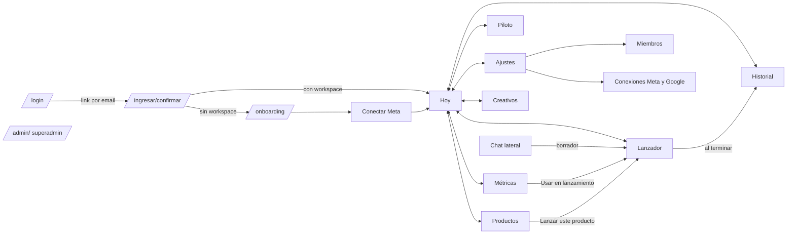

# App Flow — Lanzador

Las rutas de API son las de `docs/02-TRD.md`. Todas viven bajo `/api` y, salvo auth, bajo `/api/w/:workspaceId/...`. Si hay diferencia de nombre entre este doc y el TRD, manda el TRD.

## Mapa de pantallas

Navegación: barra lateral fija en desktop (Hoy, Lanzador, Métricas, Piloto, Creativos, Productos, Historial, Ajustes) y barra inferior con 4 accesos + "Más" en mobile. Selector de workspace arriba. Chat lateral abre con `Ctrl+K` o el botón "Pedile a la IA".

## Rutas protegidas y redirecciones

| Ruta | Requiere | Si no cumple |
|---|---|---|
| `/login`, `/ingresar/confirmar` | nada | si ya hay sesión, va a `/w/:id/hoy` |
| `/invitacion` | nada (con o sin sesión) | token inválido o vencido → "Invitación vencida" |
| `/onboarding` | sesión | sin sesión → `/login?next=` |
| `/w/:id/*` | sesión + membresía en el workspace | sin sesión → `/login`; sin membresía → 404 |
| `/w/:id/lanzador`, `/w/:id/lanzador/:launchId`, acciones de Meta | rol `editor` o superior | botones ocultos y API responde 403 |
| `/w/:id/ajustes/conexiones` | `editor` o superior (bloque de Google); el bloque de Meta pide `admin` | `viewer`: sección oculta; bloque de Meta oculto y API 403 |
| `/w/:id/ajustes/miembros`, `/w/:id/ajustes/general` | `admin` o superior | 403 con mensaje |
| Ajustes › Peligro | `owner` | sección oculta y API 403 |
| `/admin` | `superadmin` | 404 |

Sin conexión de Meta activa: Lanzador, Métricas y Piloto muestran un estado vacío con el botón "Conectar Meta".

## Estados comunes

- **Carga:** skeleton con la forma del contenido; nunca spinner de página completa.
- **Vacío:** ilustración mínima, una frase y la acción principal.
- **Error:** mensaje en lenguaje claro + "Reintentar"; errores de Meta muestran el código y qué hacer.
- **Éxito:** toast de 4 s; acciones optimistas se revierten si la API falla, con toast de error.

---

## Pantallas

### Login `/login`

- Propósito: pedir el link de acceso.
- Campo email + botón **Enviarme el link** → `POST /api/auth/magic-link`. Valida formato de email en el cliente. Siempre responde lo mismo exista o no el email ("Si tenés acceso, te llegó un email"). 429 → "Probá en unos minutos".
- Pantalla de "Revisá tu email" con botón **Reenviar** deshabilitado 60 s.

### Verificar `/ingresar/confirmar#t=<token>`

- El token viaja en el fragmento (`#t=`), no en la query, para que no llegue a logs ni al servidor. Muestra el botón **Entrar como `<email>`**; no hay POST automático al cargar la página. El clic llama al POST de verificación (F1 del TRD) con `{token}` (no GET con efecto) y el botón pasa a cargando. Éxito → crea sesión y redirige a `next` o a Hoy u Onboarding. Error → mensaje con la causa. Vencido o usado (410 `LINK_EXPIRED`) → "Link vencido" + **Pedir otro**.

### Onboarding `/onboarding`

1. **Nombre del workspace** → `POST /api/workspaces`. Solo si el email tiene invitación beta; si no, pantalla "Estás en lista de espera".
2. **Conectar Meta** → botón que llama `POST /api/w/:id/meta/connect`, devuelve `{authorizeUrl}` y navega a Facebook Login for Business. Vuelta en `GET /api/meta/oauth/callback` → redirige a `/w/:id/ajustes/conexiones?resultado=ok` (o `?resultado=error&motivo=<code>`).
3. **Elegir activos:** lista de cuentas publicitarias, páginas, Instagram y píxeles (`GET /api/w/:id/meta/assets`). Checkboxes, **Guardar** → `PATCH /api/w/:id/meta/assets` con `{changes}`. 422 `PLAN_AD_ACCOUNT_LIMIT` si supera el plan.
4. **Primer producto** (opcional, **Saltar**) → abre el formulario de producto.

Si alguien acepta una invitación de workspace (link del email a `/invitacion#t=<token>` → `POST /api/invitations/accept` con `{token}`), salta el onboarding y entra a Hoy.

### Hoy `/w/:id/hoy`

- Datos: `GET /api/w/:id/today` (gasto hoy vs ayer por cuenta, alertas, propuestas pendientes, últimos 5 lanzamientos, hora de actualización).
- Botones:
  - **Actualizar** → `POST /api/w/:id/metrics/refresh` (máximo 1 por minuto; deshabilitado con cuenta regresiva de 60 s).
  - Alerta "Reconectar Meta" → flujo de Conectar Meta.
  - Propuesta del piloto: **Aprobar** / **Descartar** (igual que en Piloto).
  - Lanzamiento en pausa: **Activar** → modal de confirmación con cantidad de anuncios y presupuesto → `POST /api/w/:id/launches/:lid/activate`.
- Se refresca cada 60 s solo con la pestaña visible, y al volver el foco.

### Lanzador `/w/:id/lanzador` (wizard de 6 pasos)

Barra de pasos arriba; se puede volver a cualquier paso ya completo. El borrador se guarda solo (`PATCH /api/w/:id/launches/:lid` con `{draft}` y debounce 1 s; el borrador nace con `POST /api/w/:id/launches` al entrar). `/w/:id/lanzador` crea o reabre el borrador y redirige a `/w/:id/lanzador/:launchId?paso=n`. Google vuelve a `/w/:id/lanzador/:launchId?google=ok|error` (el `launchId` se guarda en `oauth_states` junto al `state` del OAuth), así que reabre ese mismo borrador.

1. **Cuenta y píxel:** selects de cuenta publicitaria, página, Instagram y píxel habilitados (`GET /api/w/:id/meta/assets`). Muestra estado de la cuenta (campo `health` del activo): si está deshabilitada o con problema de pago, bloquea **Siguiente**. La cuenta elegida acá es la que recibe los medios del paso 4.
2. **Estructura:** radio **CBO nueva** / **Conjunto nuevo en CBO existente**.
   - Existente: buscador de campañas de la cuenta (`GET /api/w/:id/meta/ad-accounts/:assetId/campaigns?status=ACTIVE,PAUSED`, el filtro por texto es local). Al elegir, muestra el público y el evento que se copiarán (`GET /api/w/:id/meta/campaigns/:cid/reference?adAccountAssetId=`).
   - Nombres de campaña y conjunto con placeholders `{producto}`, `{fecha}`, `{hora}`, `{n}` y vista previa.
3. **Producto y copys:** select de producto (o **Crear producto** en modal). Muestra landing con estado del chequeo; si falla, bloquea. Lista de copys guardados del producto con checkboxes (`GET /api/w/:id/products/:pid/copies`); botón **Generar con IA** abre panel con ángulo + **Generar** → `POST /api/w/:id/products/:pid/copies/generate` (5 variantes; **Usar**, **Editar**, **Guardar en el producto**). Con varios copys elegidos, se reparten en los anuncios (rotación) o se usa uno por anuncio según el toggle.
4. **Creativos:** tres pestañas.
   - **Subir:** zona de arrastre (video e imagen, video ≤ 500 MB, imagen ≤ 30 MB), deshabilitada hasta elegir la cuenta publicitaria del paso 1. Los archivos van del navegador al Worker y de ahí directo a Meta; no se guardan en ningún lado. Por archivo: `POST /api/w/:id/uploads` con `{adAccountAssetId, fileName, contentType, sizeBytes, sha256, width?, height?, durationMs?}` (devuelve `uploadId`, `creativeId`, `nextChunk` y `duplicateOf?` si ya estaba subido) → `PUT /api/w/:id/uploads/:uid/chunk?start=<n>` con bloques de hasta 10 MiB siguiendo `nextChunk` hasta que sea `null` (409 `UPLOAD_OFFSET_MISMATCH` devuelve el `nextChunk` correcto; 413 `CHUNK_TOO_LARGE`) → `POST /api/w/:id/uploads/:uid/complete` (video: queda `processing` hasta que Meta lo termine; imagen: `ready`). Mientras algún creativo esté en `importing` o `processing`, el cliente consulta `GET /api/w/:id/creatives?ids=` cada 3 s. Barra de progreso por archivo, 3 reintentos por bloque, **Cancelar** (`POST .../abort`). Aviso "No cierres esta pestaña mientras sube". Si la subida falla o vence (410 `UPLOAD_EXPIRED`, 24 h), **Volver a subir** manda el archivo de nuevo desde la compu; si cerraste la pestaña hay que elegirlo otra vez.
   - **Etiquetado:** al terminar de subir, el navegador arma una hoja de contacto JPEG (3 cuadros del video, o la imagen reducida; ≤ 1 MB) y la manda con `POST /api/w/:id/creatives/:cid/tag`. El Worker la analiza con la IA y guarda solo las etiquetas; la imagen no se guarda.
   - **Google Drive:** **Elegir de Drive** abre Google Picker (si no hay conexión: **Conectar Google** → `POST /api/w/:id/google/connect` con `{launchId}`; el callback vuelve a `/w/:id/lanzador/:launchId?google=ok|error`). Los archivos elegidos → `POST /api/w/:id/google/imports` con `{adAccountAssetId, files}` y pasan de Drive a Meta en segundo plano; cada uno aparece como `importing` con su progreso (`GET /api/w/:id/creatives?ids=` cada 3 s mientras algún creativo esté en `importing` o `processing`). Se etiquetan solos con la miniatura de Meta.
   - **Copiar de otra campaña:** elegir campaña → lista de anuncios con miniatura, gasto y ROAS (`GET /api/w/:id/meta/campaigns/:cid/ads?adAccountAssetId=&range=`) → checkboxes.
   - Lista final ordenable (arrastrar), con nombre propuesto por IA editable, etiquetas y **Quitar**.
5. **Presupuesto y entrega:** presupuesto diario (solo CBO nueva; valida tope del workspace), estrategia (**Mayor volumen** / **Límite de costo** + monto), países (chips, default AR), evento de optimización, **Programar inicio** (fecha y hora local) opcional.
6. **Revisión:** resumen de todo lo que se va a crear, con alertas. Botones:
   - **Simular** → `POST /api/w/:id/launches/:lid/simulate`: muestra el plan exacto (`LaunchPlan`) o los bloqueos por campo. Un creativo subido a otra cuenta publicitaria bloquea con `MEDIA_NOT_IN_ACCOUNT`: "Volvé a subirlo para esta cuenta".
   - **Lanzar en pausa** → confirmación → `POST /api/w/:id/launches/:lid/start` con `{confirm:true, planHash}` (409 `PLAN_CHANGED` si el plan cambió desde la simulación). Pasa a la vista de progreso.

**Vista de progreso** (misma ruta, estado `running`): lista de anuncios con estado (procesando video, creando, verificando, listo, error). Los medios ya están en Meta desde el paso 4; el lanzamiento los reutiliza. Polling de `GET /api/w/:id/launches/:lid/progress?since=` cada 3 s (lo dicta `nextPollMs` del servidor) solo mientras corre; se corta cuando `nextPollMs` es `null`. Al terminar:
- Verificación en verde → **Activar ahora**, **Programar** (si no se programó antes) o **Dejar en pausa** (`POST .../activate` con `{confirm:true, startAt?}`).
- Con errores → **Reintentar fallidos** (`POST .../retry-failed`), **Verificar de nuevo** (`POST .../verify`) y detalle del error de cada anuncio.
- **Ver en Meta** abre Ads Manager en la campaña.

### Métricas `/w/:id/metricas`

- Filtros: rango (Hoy, Ayer, 7 d, 14 d, 30 d, Este mes, personalizado), cuenta, producto, nivel (cuenta, campaña, conjunto, anuncio). Se guardan en la URL.
- Datos: `GET /api/w/:id/metrics?level=&range=&from=&to=&adAccountIds=&productId=&cursor=` (paginado por cursor; el cliente pide `limit=50`, la API usa 25 por defecto). Columnas: nombre, estado, gasto, compras, valor, ROAS, CPA, CTR, CPM, variación vs período anterior.
- Acciones por fila (editor+):
  - **Pausar** / **Activar** (optimista) → `POST /api/w/:id/meta/objects/:oid/status`.
  - **Escalar** (solo campaña con presupuesto de campaña) → modal con % (1–50) y monto resultante → `POST /api/w/:id/meta/campaigns/:cid/scale`.
  - **Proteger** (candado) → `PUT /api/w/:id/protected-campaigns/:cid`.
- **Mejores anuncios:** pestaña con top por ROAS con gasto mínimo (`GET /api/w/:id/metrics/top-ads`); **Usar en un lanzamiento** crea un borrador con esos anuncios en "Copiar de otra campaña".
- **Qué gana:** pestaña con ROAS y CPA por etiqueta de IA (`GET /api/w/:id/metrics/winning-tags?dimension=`).
- **Exportar CSV** → `GET /api/w/:id/metrics/export.csv` con los mismos filtros.

### Piloto `/w/:id/piloto`

- Lista de propuestas pendientes (`GET /api/w/:id/pilot/proposals?status=pending`): objeto, acción (pausar, escalar X %, duplicar ganador), datos que la justifican, explicación de la IA.
- **Aprobar** → modal con el detalle exacto (y monto final si es escalar) → `POST /api/w/:id/pilot/proposals/:pid/approve`. **Descartar** → `POST .../dismiss`.
- **Correr ahora** → `POST /api/w/:id/pilot/run` (máximo 1 cada 5 min; síncrono, sin polling).
- Pestaña **Reglas** (admin+): lista editable con umbrales y activar/desactivar → `PUT /api/w/:id/pilot/rules`.
- Pestaña **Historial** de propuestas ejecutadas, descartadas y fallidas.

### Creativos `/w/:id/creativos`

- Biblioteca de creativos (`GET /api/w/:id/creatives?tag=&adAccountAssetId=&sort=recent|most_used&cursor=`), con miniatura, etiquetas de IA y en cuántos lanzamientos se usó. Cada creativo pertenece a una cuenta publicitaria; el selector de cuenta filtra la lista. ROAS acumulado por creativo: después del MVP.
- **Subir** desde la biblioteca: se elige primero la cuenta publicitaria y después se sigue el mismo flujo de subida del Lanzador (paso 4).
- **Editar etiquetas** → `PATCH /api/w/:id/creatives/:cid`. **Re-etiquetar con IA** → `POST .../retag` (usa la miniatura de Meta). **Archivar** → `POST .../archive`.
- **Usar en lanzamiento** (selección múltiple) → nuevo borrador con esos creativos. Si alguno es de otra cuenta, la simulación lo marca "Volvé a subirlo para esta cuenta".

### Productos `/w/:id/productos`

- Lista (`GET /api/w/:id/products`). **Nuevo** / **Editar** abre formulario: nombre, landing URL (**Probar** → `POST .../products/:pid/check-landing`, disponible una vez guardado el producto), texto, título, descripción, CTA (select), UTM (con vista previa del link final), precio, costo, moneda. Muestra ROAS de equilibrio y ganancia por venta en vivo.
- **Guardar** → `POST /api/w/:id/products` o `PATCH /api/w/:id/products/:pid`. **Duplicar** → `POST .../duplicate`. **Archivar** (no borra) → `POST .../archive` con `{archived:true}`.
- Pestaña **Copys** del producto (`GET .../products/:pid/copies`): guardados y favoritos (`PATCH /api/w/:id/copies/:copyId`); copy manual (`POST .../products/:pid/copies`); **Generar con IA** (`POST .../copies/generate`).
- **Lanzar este producto** → borrador con el producto elegido.

### Historial `/w/:id/historial`

- Pestaña **Lanzamientos** (`GET /api/w/:id/launches?status=&cursor=`): fecha, producto, cuenta, anuncios ok/error, estado (borrador, corriendo, en pausa, activo, programado, con errores). Clic → detalle (misma vista de progreso). Desde un lanzamiento en pausa: **Activar**.
- Pestaña **Acciones** (`GET /api/w/:id/audit?origin=&action=&actorUserId=&cursor=`): quién, qué, cuándo, objeto, origen, resultado. Filtros por origen y usuario (la lista de usuarios sale de `GET /api/w/:id/members`).

### Ajustes `/w/:id/ajustes`

- **General** (admin+): nombre, zona horaria, moneda de referencia, tope de presupuesto por campaña, permitir mejoras de Advantage+ creative (default no), plantillas de nombres → `GET`/`PATCH /api/w/:id/settings`.
- **Conexiones** (editor+, llega con `?resultado=` tras el callback de Meta): bloque de Meta (admin+; `GET /api/w/:id/meta/connections`: cuentas habilitadas, vencimiento, **Reconectar**, **Elegir activos** con `POST .../meta/connections/:cid/refresh-assets` + `PATCH /meta/assets`, **Desconectar** con confirmación que avisa "Se van de la biblioteca N creativos de esas cuentas (siguen en Meta)." → `DELETE /api/w/:id/meta/connections/:cid`), bloque de Google (editor+; `GET .../google/connection`; **Conectar** → `POST .../google/connect` sin body, el callback vuelve a `/w/:id/ajustes/conexiones?google=ok|error`; **Desconectar** → `DELETE .../google/connection`).
- **Miembros** (admin+): lista (`GET .../members`), **Invitar** (email + rol → `POST /api/w/:id/invitations`), revocar invitación (`DELETE .../invitations/:iid`), cambiar rol (`PATCH .../members/:uid`), **Quitar** (`DELETE .../members/:uid`). El owner no se puede quitar; **Transferir propiedad** (owner) → `POST .../transfer-ownership`.
- **IA:** créditos de IA del día y del mes vs tope, desde `aiUsage` de `GET /api/w/:id` (`neuronsToday`, `dailyCap`, `neuronsMonth`, `monthlyCap`, `globalExhausted`, `resetsAt`): "1.240 de 2.000 créditos de IA hoy · 8.300 de 30.000 este mes". Se renuevan a las 21 h (medianoche UTC).
- **Cuenta:** cerrar sesión (`POST /api/auth/logout`), cerrar todas las sesiones (`POST /api/auth/logout-all`).
- **Peligro** (owner): borrar workspace (escribir el nombre para confirmar) → `DELETE /api/w/:id`. Borrado lógico; se purga de D1 a los 7 días (el superadmin puede restaurarlo). No toca nada en Meta.

### Chat lateral (IA)

- Panel a la derecha (pantalla completa en mobile). Conversación nueva → `POST /api/w/:id/chat/sessions`; mensajes → `POST /api/w/:id/chat/sessions/:sid/messages` (respuesta completa en JSON, sin streaming).
- La IA puede consultar productos, cuentas, campañas y creativos del workspace y armar un borrador.
- Cuando el borrador está listo, muestra la tarjeta **Abrir en el lanzador** → navega al paso 6 (Revisión) del borrador. El chat nunca lanza, activa, pausa ni cambia presupuestos.

### Admin `/admin` (superadmin)

- Workspaces con miembros, último uso y estado de conexión (`GET /api/admin/workspaces`: `memberCount`, `lastActivityAt`, `metaStatus`) y consumo de IA en créditos (`GET /api/admin/usage`).
- **Invitar beta** (email) → `POST /api/admin/beta-invites`; revocar → `DELETE /api/admin/beta-invites/:id`.
- **Suspender workspace** → `PATCH /api/admin/workspaces/:id` con `{status:"disabled", disabledReason?}`. Con `{status:"active"}` reactiva, y sobre un workspace en `deleting` (dentro de los 7 días) cancela el borrado.
- **Errores** del front y del back → `GET /api/admin/errors`.

---

## Agregados de UX (de `docs/04-UI-UX-brief.md` §11)

Aceptados para el MVP:

- **Lanzamiento en segundo plano:** si el usuario sale de la vista de progreso, la barra superior muestra "Lanzando 14/20". Se consulta `GET /api/w/:id/launches/:lid/progress` al volver el foco o al navegar, nunca con polling fuera de la vista. Al terminar, toast con link al resultado.
- **Deshacer** en el toast de Pausar/Activar (6 s): llama al endpoint de estado con el valor anterior.
- **Autoguardado visible** en el pie del lanzador: "Guardado", "Guardando…", "Sin conexión".
- **Tema** Claro, Oscuro o Sistema en Ajustes › Cuenta (guardado en el navegador).
- **Aprobar desde Hoy en mobile:** la propuesta abre en una hoja inferior con el comprobante, sin ir a Piloto.
- **Vista previa del anuncio** en Lanzador › Revisión: copy + creativo + CTA como en el feed, uno por combinación distinta.
- **Tope de IA alcanzado** (día, mes o tope global, según `aiUsage`): "Pedile a la IA" y "Generar con IA" se deshabilitan con el motivo ("Usaste toda la IA de hoy. Se renueva a las 21 h."). Si igual llega un 422 `AI_BUDGET_EXHAUSTED`, la UI muestra el mismo mensaje con `details.resetsAt`.
- **Historial › Acciones** enlaza cada acción del piloto con su propuesta y explicación.

Para después del MVP: elegir columnas y densidad en Métricas; página de atajos de teclado.

## Flujos clave

### Login y registro

1. Usuario en `/login` escribe email → link por email.
2. Abre el link → `/ingresar/confirmar#t=<token>` → sesión creada (cookie de 30 días absolutos y 7 de inactividad; rotar no extiende el tope absoluto).
3. Sin workspace y con invitación beta → onboarding. Sin invitación → lista de espera.

No hay contraseñas; "recuperar contraseña" no aplica. Perder acceso al email: sin recuperación en el MVP; soporte manual.

### Conectar Meta

1. Ajustes › Conexiones o Onboarding → **Conectar Meta**.
2. Facebook Login for Business: el usuario elige su Business y los activos que comparte.
3. `GET /api/meta/oauth/callback` valida `state`, cambia el código por el token, lo guarda cifrado y redirige a `/w/:id/ajustes/conexiones?resultado=ok` para **Elegir activos** (o `?resultado=error&motivo=` si falla).
4. El usuario marca qué cuentas, páginas, Instagram y píxeles usa la app.

### Lanzamiento completo

1. Lanzador paso 1 a 5 (o borrador desde chat, producto, creativos o mejores anuncios). Los medios se suben a Meta en el paso 4, ya con la cuenta elegida.
2. Revisión → **Simular** → **Lanzar en pausa**.
3. Job: reutiliza los medios ya subidos, espera el procesamiento de video, crea campaña o conjunto, creativos y anuncios en pausa, verifica.
4. Usuario elige **Activar ahora**, **Programar** o **Dejar en pausa**.
5. Queda en Historial y en el registro de acciones.

### Piloto

1. Cron cada 6 h (o **Correr ahora**) refresca métricas y aplica reglas.
2. Cada regla que se cumple crea una propuesta; la IA agrega la explicación.
3. Usuario aprueba o descarta en Piloto u Hoy; aprobar ejecuta en Meta y audita.
