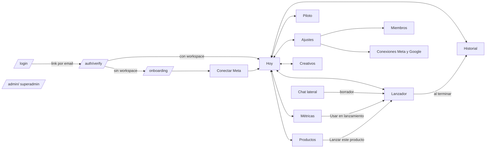

# App Flow — Lanzador

Las rutas de API son las de `docs/02-TRD.md`. Todas viven bajo `/api` y, salvo auth, bajo `/api/w/:workspaceId/...`. Si hay diferencia de nombre entre este doc y el TRD, manda el TRD.

## Mapa de pantallas

Navegación: barra lateral fija en desktop (Hoy, Lanzador, Métricas, Piloto, Creativos, Productos, Historial, Ajustes) y barra inferior con 4 accesos + "Más" en mobile. Selector de workspace arriba. Chat lateral abre con `Ctrl+K` o el botón "Pedile a la IA".

## Rutas protegidas y redirecciones

| Ruta | Requiere | Si no cumple |
|---|---|---|
| `/login`, `/auth/verify` | nada | si ya hay sesión, va a `/w/:id/hoy` |
| `/onboarding` | sesión | sin sesión → `/login?next=` |
| `/w/:id/*` | sesión + membresía en el workspace | sin sesión → `/login`; sin membresía → 404 |
| `/w/:id/lanzador`, acciones de Meta | rol `editor` o superior | botones ocultos y API responde 403 |
| `/w/:id/ajustes/miembros`, conexiones | `admin` o superior | 403 con mensaje |
| `/admin` | `superadmin` | 404 |

Sin conexión de Meta activa: Lanzador, Métricas y Piloto muestran un estado vacío con el botón "Conectar Meta".

## Estados comunes

- **Carga:** skeleton con la forma del contenido; nunca spinner de página completa.
- **Vacío:** ilustración mínima, una frase y la acción principal.
- **Error:** mensaje en lenguaje claro + "Reintentar"; errores de Meta muestran el código y qué hacer.
- **Éxito:** toast de 4 s; acciones optimistas se revierten si la API falla, con toast de error.

---

## Pantallas

### Login `/login`

- Propósito: pedir el link de acceso.
- Campo email + botón **Enviarme el link** → `POST /api/auth/magic-link`. Valida formato de email en el cliente. Siempre responde lo mismo exista o no el email ("Si tenés acceso, te llegó un email"). 429 → "Probá en unos minutos".
- Pantalla de "Revisá tu email" con botón **Reenviar** deshabilitado 60 s.

### Verificar `/auth/verify?token=`

- Llama `POST /api/auth/verify` con el token (no GET con efecto). Éxito → crea sesión y redirige a `next` o a Hoy u Onboarding. Vencido o usado → "Link vencido" + **Pedir otro**.

### Onboarding `/onboarding`

1. **Nombre del workspace** → `POST /api/workspaces`. Solo si el email tiene invitación beta; si no, pantalla "Estás en lista de espera".
2. **Conectar Meta** → botón que lleva a `GET /api/w/:id/meta/connect` (redirige a Facebook Login for Business). Vuelta en `/api/meta/callback` → redirige a `/w/:id/ajustes/conexiones?paso=assets`.
3. **Elegir activos:** lista de cuentas publicitarias, páginas, Instagram y píxeles (`GET /api/w/:id/meta/assets/available`). Checkboxes, **Guardar** → `PUT /api/w/:id/meta/assets`.
4. **Primer producto** (opcional, **Saltar**) → abre el formulario de producto.

Si alguien acepta una invitación de workspace (`/invite/:token` → `POST /api/invitations/:token/accept`), salta el onboarding y entra a Hoy.

### Hoy `/w/:id/hoy`

- Datos: `GET /api/w/:id/today` (gasto hoy vs ayer por cuenta, alertas, propuestas pendientes, últimos 5 lanzamientos, hora de actualización).
- Botones:
  - **Actualizar** → `POST /api/w/:id/insights/refresh` (máximo 1 cada 5 min; deshabilitado con cuenta regresiva).
  - Alerta "Reconectar Meta" → flujo de Conectar Meta.
  - Propuesta del piloto: **Aprobar** / **Descartar** (igual que en Piloto).
  - Lanzamiento en pausa: **Activar** → modal de confirmación con cantidad de anuncios y presupuesto → `POST /api/w/:id/launches/:lid/activate`.
- Refresca al volver el foco a la pestaña; sin polling.

### Lanzador `/w/:id/lanzador` (wizard de 6 pasos)

Barra de pasos arriba; se puede volver a cualquier paso ya completo. El borrador se guarda solo (`PUT /api/w/:id/launches/:lid` con debounce 1 s; el borrador nace con `POST /api/w/:id/launches` al entrar).

1. **Cuenta y píxel:** selects de cuenta publicitaria, página, Instagram y píxel habilitados. Muestra estado de la cuenta (`GET /api/w/:id/meta/accounts/:act/health`): si está deshabilitada o con problema de pago, bloquea **Siguiente**.
2. **Estructura:** radio **CBO nueva** / **Conjunto nuevo en CBO existente**.
   - Existente: buscador de campañas activas de la cuenta (`GET /api/w/:id/meta/campaigns?account=&q=`). Al elegir, muestra el público y el evento que se copiarán (`GET .../campaigns/:cid/reference`).
   - Nombres de campaña y conjunto con placeholders `{producto}`, `{fecha}`, `{hora}` y vista previa.
3. **Producto y copys:** select de producto (o **Crear producto** en modal). Muestra landing con estado del chequeo; si falla, bloquea. Lista de copys guardados del producto con checkboxes; botón **Generar con IA** abre panel con ángulo + **Generar** → `POST /api/w/:id/ai/copies` (5 variantes; **Usar**, **Editar**, **Guardar en el producto**). Con varios copys elegidos, se reparten en los anuncios (rotación) o se usa uno por anuncio según el toggle.
4. **Creativos:** tres pestañas.
   - **Subir:** zona de arrastre (video e imagen). Por archivo: `POST /api/w/:id/uploads` (crea multipart) → `PUT /api/w/:id/uploads/:uid/parts/:n` por partes de 10 MB → `POST /api/w/:id/uploads/:uid/complete`. Barra de progreso por archivo, reintento por parte, cancelar. El navegador saca 3 frames por video y los sube con `POST /api/w/:id/creatives/:cid/frames`; dispara el etiquetado de IA.
   - **Google Drive:** **Elegir de Drive** abre Google Picker (si no hay conexión: **Conectar Google**). Los archivos elegidos → `POST /api/w/:id/drive/import` y se copian en segundo plano; cada uno aparece con su progreso.
   - **Copiar de otra campaña:** elegir campaña → lista de anuncios con miniatura, gasto y ROAS (`GET .../campaigns/:cid/ads`) → checkboxes.
   - Lista final ordenable (arrastrar), con nombre propuesto por IA editable, etiquetas y **Quitar**.
5. **Presupuesto y entrega:** presupuesto diario (solo CBO nueva; valida tope del workspace), estrategia (**Mayor volumen** / **Límite de costo** + monto), países (chips, default AR), evento de optimización, **Programar inicio** (fecha y hora local) opcional.
6. **Revisión:** resumen de todo lo que se va a crear, con alertas. Botones:
   - **Simular** → `POST /api/w/:id/launches/:lid/simulate`: muestra el plan exacto o los errores por campo.
   - **Lanzar en pausa** → confirmación → `POST /api/w/:id/launches/:lid/run`. Pasa a la vista de progreso.

**Vista de progreso** (misma ruta, estado `running`): lista de anuncios con estado (subiendo, procesando video, creando, verificando, listo, error). Polling de `GET /api/w/:id/launches/:lid` cada 3 s solo mientras corre; se corta al terminar. Al terminar:
- Verificación en verde → **Activar ahora**, **Programar** (si no se programó antes) o **Dejar en pausa**.
- Con errores → **Reintentar fallidos** (`POST .../retry`) y detalle del error de cada anuncio.
- **Ver en Meta** abre Ads Manager en la campaña.

### Métricas `/w/:id/metricas`

- Filtros: rango (Hoy, Ayer, 7 d, 14 d, 30 d, personalizado), cuenta, producto, nivel (campaña, conjunto, anuncio). Se guardan en la URL.
- Datos: `GET /api/w/:id/insights?level=&from=&to=&account=&product=&page=` (paginado, 50 filas). Columnas: nombre, estado, gasto, compras, valor, ROAS, CPA, CTR, CPM, variación vs período anterior.
- Acciones por fila (editor+):
  - **Pausar** / **Activar** (optimista) → `POST /api/w/:id/meta/objects/:oid/status`.
  - **Escalar** (solo campaña con presupuesto de campaña) → modal con % (10–50) y monto resultante → `POST /api/w/:id/meta/campaigns/:cid/scale`.
  - **Proteger** (candado) → `PUT /api/w/:id/protected-campaigns/:cid`.
- **Mejores anuncios:** pestaña con top por ROAS con gasto mínimo (`GET /api/w/:id/insights/top-ads`); **Usar en un lanzamiento** crea un borrador con esos anuncios en "Copiar de otra campaña".
- **Qué gana:** pestaña con ROAS y CPA por etiqueta de IA (`GET /api/w/:id/insights/by-tag`).
- **Exportar CSV** → `GET /api/w/:id/insights.csv` con los mismos filtros.

### Piloto `/w/:id/piloto`

- Lista de propuestas pendientes (`GET /api/w/:id/pilot/proposals?status=pending`): objeto, acción (pausar, escalar X %, duplicar ganador), datos que la justifican, explicación de la IA.
- **Aprobar** → modal con el detalle exacto (y monto final si es escalar) → `POST .../proposals/:pid/approve`. **Descartar** → `POST .../dismiss`.
- **Correr ahora** → `POST /api/w/:id/pilot/run` (máximo 1 cada 15 min).
- Pestaña **Reglas** (admin+): lista editable con umbrales y activar/desactivar → `PUT /api/w/:id/pilot/rules`.
- Pestaña **Historial** de propuestas aprobadas y descartadas.

### Creativos `/w/:id/creativos`

- Biblioteca de creativos subidos (`GET /api/w/:id/creatives?page=&tag=`), con miniatura, etiquetas de IA, en cuántos anuncios se usó y ROAS acumulado.
- **Editar etiquetas** → `PATCH /api/w/:id/creatives/:cid`. **Re-etiquetar con IA** → `POST .../tag`.
- **Usar en lanzamiento** (selección múltiple) → nuevo borrador con esos creativos.

### Productos `/w/:id/productos`

- Lista (`GET /api/w/:id/products`). **Nuevo** / **Editar** abre formulario: nombre, landing URL (**Probar** → `POST .../products/check-url`), texto, título, descripción, CTA (select), UTM (con vista previa del link final), precio, costo, moneda. Muestra ROAS de equilibrio y ganancia por venta en vivo.
- **Guardar** → `POST`/`PATCH /api/w/:id/products`. **Archivar** (no borra) → `PATCH` con `archived=true`.
- Pestaña **Copys** del producto: guardados y favoritos; **Generar con IA**.
- **Lanzar este producto** → borrador con el producto elegido.

### Historial `/w/:id/historial`

- Pestaña **Lanzamientos** (`GET /api/w/:id/launches?page=`): fecha, producto, cuenta, anuncios ok/error, estado (borrador, corriendo, en pausa, activo, programado, con errores). Clic → detalle (misma vista de progreso). Desde un lanzamiento en pausa: **Activar**.
- Pestaña **Acciones** (`GET /api/w/:id/audit?page=`): quién, qué, cuándo, objeto, origen, resultado. Filtros por origen y usuario.

### Ajustes `/w/:id/ajustes`

- **General** (admin+): nombre, zona horaria, moneda de referencia, tope de presupuesto por campaña, permitir mejoras de Advantage+ creative (default no), plantillas de nombres → `PUT /api/w/:id/settings`.
- **Conexiones** (admin+): estado de Meta (cuentas habilitadas, vencimiento, **Reconectar**, **Elegir activos**, **Desconectar** con confirmación → `DELETE /api/w/:id/meta/connection`), estado de Google (**Conectar**, **Desconectar**).
- **Miembros** (admin+): lista, **Invitar** (email + rol → `POST /api/w/:id/invitations`), cambiar rol (`PATCH .../members/:uid`), **Quitar** (`DELETE .../members/:uid`). El owner no se puede quitar.
- **IA:** consumo del mes vs tope (`GET /api/w/:id/ai/usage`).
- **Cuenta:** cerrar sesión (`POST /api/auth/logout`), cerrar todas las sesiones.
- **Peligro** (owner): borrar workspace (escribir el nombre para confirmar) → `DELETE /api/w/:id`. Borra datos locales y revoca la conexión con Meta; no toca nada en Meta.

### Chat lateral (IA)

- Panel a la derecha (pantalla completa en mobile). Mensajes → `POST /api/w/:id/chat/:sid/messages` (respuesta en streaming).
- La IA puede consultar productos, cuentas, campañas, creativos y métricas del workspace y armar un borrador.
- Cuando el borrador está listo, muestra la tarjeta **Abrir en el lanzador** → navega al paso 6 (Revisión) del borrador. El chat nunca lanza, activa, pausa ni cambia presupuestos.

### Admin `/admin` (superadmin)

- Workspaces con miembros, último uso, consumo de IA y estado de conexión (`GET /api/admin/workspaces`).
- **Invitar beta** (email) → `POST /api/admin/beta-invites`.
- **Suspender workspace** → `POST /api/admin/workspaces/:id/suspend`.

---

## Agregados de UX (de `docs/04-UI-UX-brief.md` §11)

Aceptados para el MVP:

- **Lanzamiento en segundo plano:** si el usuario sale de la vista de progreso, la barra superior muestra "Lanzando 14/20". Se consulta `GET /api/w/:id/launches/:lid` al volver el foco o al navegar, nunca con polling fuera de la vista. Al terminar, toast con link al resultado.
- **Deshacer** en el toast de Pausar/Activar (6 s): llama al endpoint de estado con el valor anterior.
- **Autoguardado visible** en el pie del lanzador: "Guardado", "Guardando…", "Sin conexión".
- **Tema** Claro, Oscuro o Sistema en Ajustes › Cuenta (guardado en el navegador).
- **Aprobar desde Hoy en mobile:** la propuesta abre en una hoja inferior con el comprobante, sin ir a Piloto.
- **Vista previa del anuncio** en Lanzador › Revisión: copy + creativo + CTA como en el feed, uno por combinación distinta.
- **Tope de IA alcanzado:** "Pedile a la IA" y "Generar con IA" se deshabilitan con el motivo.
- **Historial › Acciones** enlaza cada acción del piloto con su propuesta y explicación.

Para después del MVP: elegir columnas y densidad en Métricas; página de atajos de teclado.

## Flujos clave

### Login y registro

1. Usuario en `/login` escribe email → link por email.
2. Abre el link → `/auth/verify` → sesión creada (cookie de 30 días, renovada al usarla).
3. Sin workspace y con invitación beta → onboarding. Sin invitación → lista de espera.

No hay contraseñas; "recuperar contraseña" no aplica. Perder acceso al email = el owner o superadmin cambia el email del usuario.

### Conectar Meta

1. Ajustes › Conexiones o Onboarding → **Conectar Meta**.
2. Facebook Login for Business: el usuario elige su Business y los activos que comparte.
3. Callback valida `state`, cambia el código por el token, lo guarda cifrado y redirige a **Elegir activos**.
4. El usuario marca qué cuentas, páginas, Instagram y píxeles usa la app.

### Lanzamiento completo

1. Lanzador paso 1 a 5 (o borrador desde chat, producto, creativos o mejores anuncios).
2. Revisión → **Simular** (opcional) → **Lanzar en pausa**.
3. Job: sube medios a Meta, espera el procesamiento de video, crea campaña o conjunto, creativos y anuncios en pausa, verifica.
4. Usuario elige **Activar ahora**, **Programar** o **Dejar en pausa**.
5. Queda en Historial y en el registro de acciones.

### Piloto

1. Cron cada 6 h (o **Correr ahora**) refresca métricas y aplica reglas.
2. Cada regla que se cumple crea una propuesta; la IA agrega la explicación.
3. Usuario aprueba o descarta en Piloto u Hoy; aprobar ejecuta en Meta y audita.
