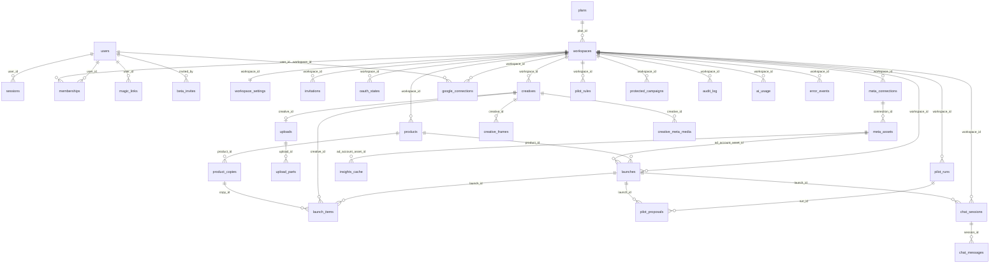

# Schema de backend — Lanzador de anuncios con IA

Fecha: 2026-11-16. Base: D1 (SQLite) con Drizzle ORM. Endpoints y flujos en `02-TRD.md`.

## 1. Convenciones

| Tema | Regla |
|---|---|
| Ids | `TEXT` UUIDv7 generado en la app (ordenado por tiempo: el id sirve de cursor y de orden de creación). Ids de Meta y Google se guardan como `TEXT` tal cual (`act_123`, `1203...`). |
| Tiempo | `INTEGER` epoch en milisegundos UTC. `created_at` en todas las tablas; `updated_at` donde hay updates. |
| Dinero | `INTEGER` en unidades menores (centavos) + `currency TEXT` (ISO 4217). Sufijo `_minor`. Costos de IA en micro-USD (`_microusd`). |
| Booleanos | `INTEGER` 0/1 con `CHECK (col IN (0,1))`. |
| Enums | `TEXT` con `CHECK (col IN (...))`; los valores viven también en `src/shared/constants.ts`. |
| JSON | `TEXT` con `CHECK (json_valid(col))`, validado con Zod al escribir y al leer. |
| Tenancy | Toda tabla con datos de un cliente tiene `workspace_id TEXT NOT NULL` (también las tablas hijas), para que el helper filtre siempre por la misma columna. |
| FKs | D1 aplica `foreign_keys` por defecto. `ON DELETE CASCADE` desde `workspaces` hacia todo lo del tenant (la purga de un workspace es un único `DELETE`). |
| Soft delete | Solo donde hay producto: `workspaces.deleted_at` (purga a 7 días), `products.archived`, `creatives.status='archived'`, `product_copies.status='discarded'`, revocaciones (`revoked_at`). Nada de Meta se borra nunca. |
| Contadores | Nunca `COUNT(*)` por request: `launches.items_*`, `chat_sessions.message_count`, `pilot_runs.proposals_created`, `workspaces.storage_bytes_used`, `usage_counters`. |

## 2. Diagrama ER

`usage_counters` y `data_deletion_requests` no tienen FK (claves de alcance libre y pedidos de Meta sin workspace conocido).

## 3. Tablas

Formato: columna · tipo · null · default · único/check · nota. `NN` = NOT NULL.

### 3.1 Plataforma y auth

#### `plans`
| Columna | Tipo | Null | Default | Único / check | Nota |
|---|---|---|---|---|---|
| id | TEXT | NN | — | PK | `beta`, `starter`, `pro` |
| name | TEXT | NN | — | | |
| max_members | INTEGER | NN | 10 | | |
| max_ad_accounts | INTEGER | NN | 10 | | cuentas publicitarias habilitadas |
| max_creatives_per_launch | INTEGER | NN | 30 | | |
| storage_bytes_limit | INTEGER | NN | 1610612736 | | 1,5 GiB de originales |
| ai_monthly_budget_microusd | INTEGER | NN | 20000000 | | US$20 |
| price_monthly_minor | INTEGER | NN | 0 | | para la fase 2 |
| currency | TEXT | NN | 'USD' | | |
| is_active | INTEGER | NN | 1 | 0/1 | |
| created_at | INTEGER | NN | — | | |

Índices: solo PK. Filas: se insertan por migración (no por seed) porque producción las necesita.

#### `users`
| Columna | Tipo | Null | Default | Único / check | Nota |
|---|---|---|---|---|---|
| id | TEXT | NN | — | PK | |
| email | TEXT | NN | — | UNIQUE | normalizado: trim + minúsculas |
| name | TEXT | sí | NULL | | |
| is_superadmin | INTEGER | NN | 0 | 0/1 | se pone en 1 al loguearse si `email = SUPERADMIN_EMAIL` |
| status | TEXT | NN | 'active' | `active`,`disabled` | |
| created_at | INTEGER | NN | — | | |
| last_login_at | INTEGER | sí | NULL | | |

Índices: `UNIQUE(email)` — `SELECT ... FROM users WHERE email = ?` en verify, aceptar invitación y elegibilidad del magic link.

#### `sessions`
| Columna | Tipo | Null | Default | Único / check | Nota |
|---|---|---|---|---|---|
| id | TEXT | NN | — | PK | interno, nunca sale |
| user_id | TEXT | NN | — | FK `users.id` ON DELETE CASCADE | |
| token_hash | TEXT | NN | — | UNIQUE | SHA-256 hex del token de 32 bytes |
| previous_token_hash | TEXT | sí | NULL | | válido 60 s tras rotar |
| rotated_at | INTEGER | NN | — | | |
| created_at | INTEGER | NN | — | | |
| last_seen_at | INTEGER | NN | — | | se actualiza como máximo 1 vez por hora |
| expires_at | INTEGER | NN | — | | absoluto: `created_at + 30 días` |
| user_agent | TEXT | sí | NULL | | truncado a 200 |
| ip_hash | TEXT | sí | NULL | | SHA-256(IP + fecha) para soporte, no la IP |

Índices:
| Índice | Query que lo justifica |
|---|---|
| `UNIQUE(token_hash)` | Cada request: `SELECT s.*, u.* FROM sessions s JOIN users u ... WHERE s.token_hash = ?` |
| `sessions_prev_hash_idx (previous_token_hash)` | Fallback durante la ventana de rotación: `WHERE previous_token_hash = ? AND rotated_at > ?` |
| `sessions_user_idx (user_id)` | Cerrar todas las sesiones al desactivar un usuario: `DELETE FROM sessions WHERE user_id = ?` |
| `sessions_expires_idx (expires_at)` | Cron: `DELETE FROM sessions WHERE expires_at < ? OR last_seen_at < ?` (idle 7 días) |

#### `magic_links`
| Columna | Tipo | Null | Default | Único / check | Nota |
|---|---|---|---|---|---|
| id | TEXT | NN | — | PK | |
| token_hash | TEXT | NN | — | UNIQUE | SHA-256 hex |
| email | TEXT | NN | — | | normalizado |
| user_id | TEXT | sí | NULL | FK `users.id` ON DELETE CASCADE | NULL si el usuario todavía no existe |
| created_at | INTEGER | NN | — | | |
| expires_at | INTEGER | NN | — | | `created_at + 15 min` |
| used_at | INTEGER | sí | NULL | | |
| invalidated_at | INTEGER | sí | NULL | | si falló el envío del email |
| ip_hash | TEXT | sí | NULL | | |

Índices:
| Índice | Query |
|---|---|
| `UNIQUE(token_hash)` | Verify atómico: `UPDATE magic_links SET used_at = ? WHERE token_hash = ? AND used_at IS NULL AND invalidated_at IS NULL AND expires_at > ? RETURNING email, user_id` |
| `magic_links_email_created_idx (email, created_at)` | Tope por email: `SELECT id FROM magic_links WHERE email = ? AND created_at > ? LIMIT 6` (≥ 5 → 429) |
| `magic_links_expires_idx (expires_at)` | Cron de limpieza |

#### `beta_invites`
| Columna | Tipo | Null | Default | Único / check | Nota |
|---|---|---|---|---|---|
| id | TEXT | NN | — | PK | |
| email | TEXT | NN | — | UNIQUE | |
| note | TEXT | sí | NULL | | |
| invited_by | TEXT | sí | NULL | FK `users.id` ON DELETE SET NULL | superadmin |
| created_at | INTEGER | NN | — | | |
| used_at | INTEGER | sí | NULL | | al crear su primer workspace |
| revoked_at | INTEGER | sí | NULL | | |

Índices: `UNIQUE(email)` — elegibilidad del magic link y de `POST /api/workspaces`: `WHERE email = ? AND revoked_at IS NULL`. `beta_invites_created_idx (created_at)` — lista del superadmin paginada por `id`/`created_at`.

#### `workspaces`
| Columna | Tipo | Null | Default | Único / check | Nota |
|---|---|---|---|---|---|
| id | TEXT | NN | — | PK | |
| name | TEXT | NN | — | | |
| plan_id | TEXT | NN | 'beta' | FK `plans.id` ON DELETE RESTRICT | |
| owner_user_id | TEXT | NN | — | FK `users.id` ON DELETE RESTRICT | |
| status | TEXT | NN | 'active' | `active`,`disabled`,`deleting` | |
| disabled_reason | TEXT | sí | NULL | | |
| ai_budget_override_microusd | INTEGER | sí | NULL | | pisa el del plan |
| storage_bytes_used | INTEGER | NN | 0 | ≥ 0 | contador de originales en R2 |
| last_activity_at | INTEGER | sí | NULL | | se actualiza como máximo 1 vez por hora; usado por el cron |
| created_at | INTEGER | NN | — | | |
| updated_at | INTEGER | NN | — | | |
| deleted_at | INTEGER | sí | NULL | | |

Índices:
| Índice | Query |
|---|---|
| `workspaces_status_created_idx (status, created_at)` | Superadmin: `WHERE status = ? ORDER BY created_at DESC LIMIT ?`; cron de purga: `WHERE status = 'deleting' AND deleted_at < ?` |
| `workspaces_owner_idx (owner_user_id)` | Tope de 3 workspaces por usuario: `SELECT id FROM workspaces WHERE owner_user_id = ? AND status != 'deleting' LIMIT 4` |
| `workspaces_activity_idx (status, last_activity_at)` | Cron de precalentado y piloto: `WHERE status = 'active' AND last_activity_at > ?` |

#### `workspace_settings`
| Columna | Tipo | Null | Default | Único / check | Nota |
|---|---|---|---|---|---|
| workspace_id | TEXT | NN | — | PK, FK `workspaces.id` ON DELETE CASCADE | 1:1 |
| max_campaign_budget_minor | INTEGER | NN | 30000 | > 0 | US$300 |
| budget_currency | TEXT | NN | 'USD' | | |
| max_scale_percent | INTEGER | NN | 50 | `BETWEEN 1 AND 50` | |
| advantage_creative_enabled | INTEGER | NN | 0 | 0/1 | |
| timezone | TEXT | NN | 'America/Argentina/Buenos_Aires' | | |
| default_countries | TEXT | NN | '["AR"]' | json_valid | |
| campaign_name_template | TEXT | NN | 'CBO {fecha}' | | |
| adset_name_template | TEXT | NN | 'CONJ {n}' | | |
| ad_name_template | TEXT | NN | '{hook}-{formato}-{angulo}-{n}' | | |
| launch_defaults | TEXT | NN | ver nota | json_valid | `{objective:"OUTCOME_SALES", bidStrategy:"LOWEST_COST_WITHOUT_CAP", optimizationGoal:"OFFSITE_CONVERSIONS", billingEvent:"IMPRESSIONS", attributionSpec:[{event_type:"CLICK_THROUGH",window_days:7},{event_type:"VIEW_THROUGH",window_days:1}], customEventType:"PURCHASE", defaultBudgetMinor:3000, targeting:{age_min:18, geo_locations:{countries:["AR"]}}}` (reemplaza `templates.json` de la app vieja) |
| updated_by | TEXT | sí | NULL | FK `users.id` ON DELETE SET NULL | |
| updated_at | INTEGER | NN | — | | |

Índices: solo PK (`WHERE workspace_id = ?`).

#### `memberships`
| Columna | Tipo | Null | Default | Único / check | Nota |
|---|---|---|---|---|---|
| id | TEXT | NN | — | PK | |
| workspace_id | TEXT | NN | — | FK `workspaces.id` ON DELETE CASCADE | |
| user_id | TEXT | NN | — | FK `users.id` ON DELETE CASCADE | |
| role | TEXT | NN | — | `owner`,`admin`,`editor`,`viewer` | |
| invited_by | TEXT | sí | NULL | FK `users.id` ON DELETE SET NULL | |
| created_at | INTEGER | NN | — | | |
| updated_at | INTEGER | NN | — | | |

Índices:
| Índice | Query |
|---|---|
| `UNIQUE(workspace_id, user_id)` | Middleware de cada request `/api/w/:wid`: `SELECT role FROM memberships WHERE workspace_id = ? AND user_id = ?`; lista de miembros `WHERE workspace_id = ? ORDER BY id` |
| `memberships_user_idx (user_id)` | `/api/me`: `SELECT m.role, w.id, w.name, w.status FROM memberships m JOIN workspaces w ... WHERE m.user_id = ?` |

Regla: un solo `owner` por workspace (se garantiza en el service y con índice único parcial `memberships_one_owner (workspace_id) WHERE role = 'owner'`).

#### `invitations`
| Columna | Tipo | Null | Default | Único / check | Nota |
|---|---|---|---|---|---|
| id | TEXT | NN | — | PK | |
| workspace_id | TEXT | NN | — | FK `workspaces.id` ON DELETE CASCADE | |
| email | TEXT | NN | — | | normalizado |
| role | TEXT | NN | — | `admin`,`editor`,`viewer` | |
| token_hash | TEXT | NN | — | UNIQUE | |
| invited_by | TEXT | sí | NULL | FK `users.id` ON DELETE SET NULL | |
| created_at | INTEGER | NN | — | | |
| expires_at | INTEGER | NN | — | | `created_at + 7 días` |
| accepted_at | INTEGER | sí | NULL | | |
| accepted_by | TEXT | sí | NULL | FK `users.id` ON DELETE SET NULL | |
| revoked_at | INTEGER | sí | NULL | | |

Índices:
| Índice | Query |
|---|---|
| `UNIQUE(token_hash)` | Aceptar: `UPDATE invitations SET accepted_at = ?, accepted_by = ? WHERE token_hash = ? AND accepted_at IS NULL AND revoked_at IS NULL AND expires_at > ? RETURNING ...` |
| `invitations_pending_unique UNIQUE(workspace_id, email) WHERE accepted_at IS NULL AND revoked_at IS NULL` | Evita duplicadas (409 `INVITATION_PENDING`) |
| `invitations_ws_created_idx (workspace_id, created_at)` | Lista paginada del admin |
| `invitations_email_idx (email)` | Elegibilidad del magic link: `WHERE email = ? AND accepted_at IS NULL AND revoked_at IS NULL AND expires_at > ? LIMIT 1` |

#### `oauth_states`
| Columna | Tipo | Null | Default | Único / check | Nota |
|---|---|---|---|---|---|
| id | TEXT | NN | — | PK | |
| state_hash | TEXT | NN | — | UNIQUE | |
| provider | TEXT | NN | — | `meta`,`google` | |
| workspace_id | TEXT | NN | — | FK `workspaces.id` ON DELETE CASCADE | |
| user_id | TEXT | NN | — | FK `users.id` ON DELETE CASCADE | debe coincidir con la sesión del callback |
| created_at | INTEGER | NN | — | | |
| expires_at | INTEGER | NN | — | | `+10 min` |
| used_at | INTEGER | sí | NULL | | |

Índices: `UNIQUE(state_hash)` — callback: `UPDATE oauth_states SET used_at = ? WHERE state_hash = ? AND provider = ? AND used_at IS NULL AND expires_at > ? RETURNING workspace_id, user_id`. `oauth_states_expires_idx (expires_at)` — cron.

### 3.2 Conexiones externas

#### `meta_connections`
| Columna | Tipo | Null | Default | Único / check | Nota |
|---|---|---|---|---|---|
| id | TEXT | NN | — | PK | |
| workspace_id | TEXT | NN | — | FK `workspaces.id` ON DELETE CASCADE | |
| meta_business_id | TEXT | NN | — | | |
| business_name | TEXT | sí | NULL | | |
| meta_user_id | TEXT | NN | — | | id de `GET me` (usuario del sistema o usuario) |
| token_type | TEXT | NN | 'system_user' | `system_user`,`user` | |
| token_ciphertext | BLOB | NN | — | | **cifrado**, nunca sale |
| token_iv | BLOB | NN | — | | 12 bytes |
| token_key_version | INTEGER | NN | — | | |
| token_expires_at | INTEGER | sí | NULL | | NULL = no vence |
| scopes | TEXT | NN | '[]' | json_valid | |
| status | TEXT | NN | 'active' | `active`,`reconnect_required` | |
| last_error_code | INTEGER | sí | NULL | | |
| last_error_at | INTEGER | sí | NULL | | |
| connected_by | TEXT | sí | NULL | FK `users.id` ON DELETE SET NULL | |
| created_at | INTEGER | NN | — | | |
| updated_at | INTEGER | NN | — | | |

Desconectar borra la fila (y en cascada sus activos e insights). La historia queda en `audit_log`.

Índices:
| Índice | Query |
|---|---|
| `UNIQUE(workspace_id, meta_business_id)` | Reconectar el mismo negocio actualiza en lugar de duplicar; lista de conexiones `WHERE workspace_id = ?` |
| `meta_connections_user_idx (meta_user_id)` | Callbacks de deautorizar y borrado: `WHERE meta_user_id = ?` |
| `meta_connections_key_idx (token_key_version)` | Cron de rotación: `WHERE token_key_version < ? LIMIT 50` |

#### `meta_assets`
| Columna | Tipo | Null | Default | Único / check | Nota |
|---|---|---|---|---|---|
| id | TEXT | NN | — | PK | `adAccountAssetId` en la API |
| workspace_id | TEXT | NN | — | FK `workspaces.id` ON DELETE CASCADE | |
| connection_id | TEXT | NN | — | FK `meta_connections.id` ON DELETE CASCADE | |
| kind | TEXT | NN | — | `ad_account`,`page`,`instagram`,`pixel` | |
| meta_id | TEXT | NN | — | | `act_…` para cuentas |
| name | TEXT | NN | — | | |
| parent_meta_id | TEXT | sí | NULL | | píxel → cuenta; instagram → página |
| currency | TEXT | sí | NULL | | solo cuentas |
| timezone_name | TEXT | sí | NULL | | solo cuentas |
| account_status | INTEGER | sí | NULL | | 1 y 201 = OK |
| disable_reason | INTEGER | sí | NULL | | |
| funding_ok | INTEGER | sí | NULL | 0/1 | |
| spend_cap_pct | INTEGER | sí | NULL | | % de `spend_cap` gastado |
| health_checked_at | INTEGER | sí | NULL | | |
| enabled | INTEGER | NN | 0 | 0/1 | |
| missing_since | INTEGER | sí | NULL | | Meta dejó de devolverlo |
| created_at | INTEGER | NN | — | | |
| updated_at | INTEGER | NN | — | | |

Índices:
| Índice | Query |
|---|---|
| `UNIQUE(workspace_id, kind, meta_id)` | Upsert del descubrimiento; validar `adAccountAssetId` por `meta_id` |
| `meta_assets_ws_kind_enabled_idx (workspace_id, kind, enabled)` | Lanzador y Hoy: `WHERE workspace_id = ? AND kind = 'ad_account' AND enabled = 1`; tope del plan |
| `meta_assets_connection_idx (connection_id)` | Re-descubrimiento por conexión |

#### `google_connections`
| Columna | Tipo | Null | Default | Único / check | Nota |
|---|---|---|---|---|---|
| id | TEXT | NN | — | PK | |
| workspace_id | TEXT | NN | — | FK `workspaces.id` ON DELETE CASCADE | |
| user_id | TEXT | NN | — | FK `users.id` ON DELETE CASCADE | la conexión es del usuario dentro del workspace |
| google_email | TEXT | NN | — | | |
| refresh_token_ciphertext | BLOB | NN | — | | **cifrado**, nunca sale |
| refresh_token_iv | BLOB | NN | — | | |
| token_key_version | INTEGER | NN | — | | |
| scopes | TEXT | NN | '[]' | json_valid | |
| status | TEXT | NN | 'active' | `active`,`reconnect_required` | |
| created_at | INTEGER | NN | — | | |
| updated_at | INTEGER | NN | — | | |

Índices: `UNIQUE(workspace_id, user_id)` — `/google/connection`, `/picker-token` y el job de importación: `WHERE workspace_id = ? AND user_id = ?`. `google_connections_key_idx (token_key_version)` — rotación.

El access token de Google no se guarda: se pide con el refresh token y se cachea en memoria de la invocación.

### 3.3 Productos y copys

#### `products`
| Columna | Tipo | Null | Default | Único / check | Nota |
|---|---|---|---|---|---|
| id | TEXT | NN | — | PK | |
| workspace_id | TEXT | NN | — | FK `workspaces.id` ON DELETE CASCADE | |
| name | TEXT | NN | — | | |
| name_normalized | TEXT | NN | — | | minúsculas, sin espacios extremos |
| landing_url | TEXT | NN | — | `LIKE 'https://%'` | |
| primary_text | TEXT | NN | — | | ≤ 125 recomendado |
| headline | TEXT | NN | — | | ≤ 40 recomendado |
| description | TEXT | sí | NULL | | ≤ 150 recomendado |
| cta | TEXT | NN | 'SHOP_NOW' | `SHOP_NOW`,`LEARN_MORE`,`ORDER_NOW`,`BUY_NOW`,`GET_OFFER`,`SIGN_UP` | |
| utm | TEXT | sí | NULL | | se envía como `url_tags` |
| price_minor | INTEGER | sí | NULL | > 0 | |
| cost_minor | INTEGER | sí | NULL | ≥ 0 y `< price_minor` | |
| currency | TEXT | NN | 'USD' | | |
| archived | INTEGER | NN | 0 | 0/1 | |
| landing_status | TEXT | NN | 'unchecked' | `unchecked`,`ok`,`soft_ok`,`error` | |
| landing_http_status | INTEGER | sí | NULL | | |
| landing_error | TEXT | sí | NULL | | |
| landing_checked_at | INTEGER | sí | NULL | | |
| created_by | TEXT | sí | NULL | FK `users.id` ON DELETE SET NULL | |
| created_at | INTEGER | NN | — | | |
| updated_at | INTEGER | NN | — | | |

ROAS de equilibrio (`price / (price − cost)`) y ganancia por venta se calculan en el service, no se guardan.

Índices:
| Índice | Query |
|---|---|
| `UNIQUE(workspace_id, name_normalized)` | Nombre único sin distinguir mayúsculas (409 `NAME_TAKEN`) |
| `products_ws_archived_updated_idx (workspace_id, archived, updated_at)` | Lista: `WHERE workspace_id = ? AND archived = ? ORDER BY updated_at DESC LIMIT ?` (búsqueda `q` filtra sobre ese rango con `name_normalized LIKE ?`, catálogos < 500 productos) |

#### `product_copies`
| Columna | Tipo | Null | Default | Único / check | Nota |
|---|---|---|---|---|---|
| id | TEXT | NN | — | PK | |
| workspace_id | TEXT | NN | — | FK `workspaces.id` ON DELETE CASCADE | |
| product_id | TEXT | NN | — | FK `products.id` ON DELETE CASCADE | |
| angle | TEXT | NN | — | `dolor`,`beneficio`,`prueba_social`,`oferta`,`urgencia`,`libre`,`manual` | |
| custom_angle | TEXT | sí | NULL | | |
| primary_text | TEXT | NN | — | | |
| headline | TEXT | NN | — | | |
| description | TEXT | sí | NULL | | |
| source | TEXT | NN | — | `ai`,`manual` | |
| edited | INTEGER | NN | 0 | 0/1 | para la métrica "≥ 60 % de copys de IA" |
| status | TEXT | NN | 'suggested' | `suggested`,`saved`,`discarded` | |
| favorite | INTEGER | NN | 0 | 0/1 | |
| policy_risk | TEXT | NN | 'none' | `none`,`low`,`high` | |
| policy_note | TEXT | sí | NULL | | |
| over_limit | INTEGER | NN | 0 | 0/1 | |
| ai_usage_id | TEXT | sí | NULL | FK `ai_usage.id` ON DELETE SET NULL | |
| created_by | TEXT | sí | NULL | FK `users.id` ON DELETE SET NULL | |
| created_at | INTEGER | NN | — | | |
| updated_at | INTEGER | NN | — | | |

Índices: `product_copies_product_status_idx (workspace_id, product_id, status, created_at)` — `GET /products/:id/copies?status=saved`: `WHERE workspace_id = ? AND product_id = ? AND status = ? ORDER BY created_at DESC`.

### 3.4 Creativos y subidas

#### `creatives`
| Columna | Tipo | Null | Default | Único / check | Nota |
|---|---|---|---|---|---|
| id | TEXT | NN | — | PK | |
| workspace_id | TEXT | NN | — | FK `workspaces.id` ON DELETE CASCADE | |
| kind | TEXT | NN | — | `video`,`image` | |
| original_filename | TEXT | NN | — | | |
| content_type | TEXT | NN | — | `video/mp4`,`video/quicktime`,`video/x-m4v`,`image/jpeg`,`image/png` | |
| size_bytes | INTEGER | NN | — | > 0 | |
| sha256 | TEXT | sí | NULL | | aviso de duplicado |
| r2_key | TEXT | NN | — | UNIQUE | `ws/<wid>/creatives/<id>/original.<ext>` |
| width | INTEGER | sí | NULL | | lo informa el navegador |
| height | INTEGER | sí | NULL | | |
| duration_ms | INTEGER | sí | NULL | | |
| source | TEXT | NN | — | `browser`,`drive` | |
| status | TEXT | NN | — | `uploading`,`importing`,`ready`,`failed`,`archived` | |
| error | TEXT | sí | NULL | | |
| storage_state | TEXT | NN | 'present' | `present`,`purged` | |
| purge_after | INTEGER | sí | NULL | | 7 días tras subir; 48 h tras quedar en Meta en un lanzamiento verificado |
| ai_status | TEXT | NN | 'pending_frames' | `pending_frames`,`queued`,`done`,`failed`,`skipped` | |
| tag_hook | TEXT | sí | NULL | | |
| tag_angle | TEXT | sí | NULL | | |
| tag_format | TEXT | sí | NULL | `ugc`,`demo`,`testimonio`,`estatico`,`otro` | |
| tag_language | TEXT | sí | NULL | | ISO 639-1 |
| tag_on_screen_text | INTEGER | sí | NULL | 0/1 | |
| tag_summary | TEXT | sí | NULL | | |
| tags_edited | INTEGER | NN | 0 | 0/1 | |
| ai_model | TEXT | sí | NULL | | |
| ad_name_suggested | TEXT | sí | NULL | | |
| ad_name | TEXT | sí | NULL | | elegido por el usuario |
| created_by | TEXT | sí | NULL | FK `users.id` ON DELETE SET NULL | |
| created_at | INTEGER | NN | — | | |
| updated_at | INTEGER | NN | — | | |

Índices:
| Índice | Query |
|---|---|
| `creatives_ws_status_created_idx (workspace_id, status, created_at)` | Biblioteca del lanzador: `WHERE workspace_id = ? AND status IN ('ready','importing') ORDER BY created_at DESC LIMIT ?`; `?ids=` va por PK + `workspace_id` |
| `creatives_ws_sha_idx (workspace_id, sha256)` | Aviso de duplicado en `POST /uploads` |
| `creatives_purge_idx (storage_state, purge_after)` | Cron: `WHERE storage_state = 'present' AND purge_after < ? LIMIT 100` |
| `creatives_ai_status_idx (ai_status, created_at)` | Reencolar etiquetado pendiente cuando vuelve el cupo diario |

#### `uploads`
| Columna | Tipo | Null | Default | Único / check | Nota |
|---|---|---|---|---|---|
| id | TEXT | NN | — | PK | |
| workspace_id | TEXT | NN | — | FK `workspaces.id` ON DELETE CASCADE | |
| creative_id | TEXT | NN | — | UNIQUE, FK `creatives.id` ON DELETE CASCADE | |
| source | TEXT | NN | — | `browser`,`drive` | |
| r2_upload_id | TEXT | sí | NULL | | multipart de R2 (solo `browser`) |
| drive_file_id | TEXT | sí | NULL | | solo `drive` |
| google_connection_id | TEXT | sí | NULL | FK `google_connections.id` ON DELETE SET NULL | |
| size_bytes | INTEGER | NN | — | | |
| part_size_bytes | INTEGER | NN | 10485760 | | |
| part_count | INTEGER | NN | — | ≤ 10000 | |
| status | TEXT | NN | 'uploading' | `uploading`,`completed`,`aborted`,`failed` | |
| error | TEXT | sí | NULL | | |
| created_by | TEXT | sí | NULL | FK `users.id` ON DELETE SET NULL | |
| created_at | INTEGER | NN | — | | |
| updated_at | INTEGER | NN | — | | |
| expires_at | INTEGER | NN | — | | `created_at + 24 h` |

Índices: `uploads_status_expires_idx (status, expires_at)` — cron: `WHERE status = 'uploading' AND expires_at < ?` (aborta en R2 y marca `aborted`). PK + `workspace_id` para las rutas de partes.

#### `upload_parts`
| Columna | Tipo | Null | Default | Único / check | Nota |
|---|---|---|---|---|---|
| upload_id | TEXT | NN | — | PK (1/2), FK `uploads.id` ON DELETE CASCADE | |
| part_number | INTEGER | NN | — | PK (2/2), `BETWEEN 1 AND 10000` | |
| workspace_id | TEXT | NN | — | FK `workspaces.id` ON DELETE CASCADE | |
| etag | TEXT | NN | — | | |
| size_bytes | INTEGER | NN | — | | |
| created_at | INTEGER | NN | — | | |

Índices: PK `(upload_id, part_number)` — `complete`: `SELECT part_number, etag FROM upload_parts WHERE upload_id = ? ORDER BY part_number`; `INSERT ... ON CONFLICT DO UPDATE` en reintentos de una parte.

#### `creative_frames`
| Columna | Tipo | Null | Default | Único / check | Nota |
|---|---|---|---|---|---|
| creative_id | TEXT | NN | — | PK (1/2), FK `creatives.id` ON DELETE CASCADE | |
| idx | INTEGER | NN | — | PK (2/2), `BETWEEN 0 AND 2` | |
| workspace_id | TEXT | NN | — | FK `workspaces.id` ON DELETE CASCADE | |
| time_ms | INTEGER | NN | 0 | | |
| r2_key | TEXT | NN | — | | `ws/<wid>/creatives/<id>/frame-<idx>.jpg` |
| width | INTEGER | NN | — | ≤ 512 | |
| height | INTEGER | NN | — | ≤ 512 | |
| size_bytes | INTEGER | NN | — | ≤ 307200 | |
| created_at | INTEGER | NN | — | | |

Índices: PK — job de etiquetado y detalle: `WHERE creative_id = ? ORDER BY idx`.

#### `creative_meta_media`
| Columna | Tipo | Null | Default | Único / check | Nota |
|---|---|---|---|---|---|
| id | TEXT | NN | — | PK | |
| workspace_id | TEXT | NN | — | FK `workspaces.id` ON DELETE CASCADE | |
| creative_id | TEXT | NN | — | FK `creatives.id` ON DELETE CASCADE | |
| ad_account_meta_id | TEXT | NN | — | | |
| meta_video_id | TEXT | sí | NULL | | |
| meta_image_hash | TEXT | sí | NULL | | |
| upload_method | TEXT | NN | — | `file_url`,`resumable`,`image` | |
| status | TEXT | NN | — | `uploading`,`processing`,`ready`,`error` | |
| thumbnail_url | TEXT | sí | NULL | | |
| is_horizontal | INTEGER | sí | NULL | 0/1 | aviso 9:16 / 4:5 |
| error | TEXT | sí | NULL | | |
| created_at | INTEGER | NN | — | | |
| updated_at | INTEGER | NN | — | | |

Índices: `UNIQUE(creative_id, ad_account_meta_id)` — `LaunchItemWorkflow` reusa el video si ya está en esa cuenta: `WHERE creative_id = ? AND ad_account_meta_id = ? AND status = 'ready'`.

### 3.5 Lanzamientos

#### `launches`
| Columna | Tipo | Null | Default | Único / check | Nota |
|---|---|---|---|---|---|
| id | TEXT | NN | — | PK | |
| workspace_id | TEXT | NN | — | FK `workspaces.id` ON DELETE CASCADE | |
| status | TEXT | NN | 'draft' | `draft`,`simulated`,`queued`,`running`,`verifying`,`paused_verified`,`verified_with_errors`,`activating`,`active`,`scheduled`,`failed`,`discarded` | |
| phase | TEXT | sí | NULL | `preflight`,`campaign`,`adset`,`items`,`verify`,`activate` | |
| source | TEXT | NN | 'manual' | `manual`,`chat`,`pilot`,`top_ads` | |
| mode | TEXT | sí | NULL | `new_cbo`,`existing_cbo` | NULL mientras es borrador incompleto |
| ad_account_asset_id | TEXT | sí | NULL | FK `meta_assets.id` ON DELETE SET NULL | |
| ad_account_meta_id | TEXT | sí | NULL | | copia para historial si se desconecta |
| currency | TEXT | sí | NULL | | |
| product_id | TEXT | sí | NULL | FK `products.id` ON DELETE SET NULL | |
| draft | TEXT | NN | '{}' | json_valid | `LaunchDraft` |
| plan | TEXT | sí | NULL | json_valid | `LaunchPlan` de la simulación |
| plan_hash | TEXT | sí | NULL | | `start` exige que coincida |
| daily_budget_minor | INTEGER | sí | NULL | | copia indexable del borrador |
| start_at | INTEGER | sí | NULL | | "Programar" |
| meta_campaign_id | TEXT | sí | NULL | | |
| meta_adset_id | TEXT | sí | NULL | | |
| items_total | INTEGER | NN | 0 | | contador |
| items_done | INTEGER | NN | 0 | | contador |
| items_failed | INTEGER | NN | 0 | | contador |
| checks | TEXT | sí | NULL | json_valid | `[{ok,code,text}]` |
| checks_ok | INTEGER | sí | NULL | 0/1 | |
| attempt | INTEGER | NN | 0 | | id de instancia `launch-<id>-<attempt>` |
| workflow_instance_id | TEXT | sí | NULL | | |
| error_code | TEXT | sí | NULL | | |
| error_message | TEXT | sí | NULL | | |
| created_by | TEXT | sí | NULL | FK `users.id` ON DELETE SET NULL | |
| started_by | TEXT | sí | NULL | FK `users.id` ON DELETE SET NULL | |
| activated_by | TEXT | sí | NULL | FK `users.id` ON DELETE SET NULL | |
| created_at | INTEGER | NN | — | | |
| started_at | INTEGER | sí | NULL | | |
| finished_at | INTEGER | sí | NULL | | |
| activated_at | INTEGER | sí | NULL | | |
| updated_at | INTEGER | NN | — | | |

Índices:
| Índice | Query |
|---|---|
| `launches_ws_created_idx (workspace_id, created_at)` | Historial: `WHERE workspace_id = ? ORDER BY created_at DESC LIMIT ?`; Hoy: últimos 5 |
| `launches_ws_status_created_idx (workspace_id, status, created_at)` | Filtro por estado en Historial; "¿hay un lanzamiento corriendo?" para el polling |
| `launches_ws_campaign_idx (workspace_id, meta_campaign_id)` | Métricas: mapa campaña → producto y "subió hace N h": `SELECT meta_campaign_id, product_id, created_at FROM launches WHERE workspace_id = ? AND meta_campaign_id IN (...)` |

#### `launch_items`
| Columna | Tipo | Null | Default | Único / check | Nota |
|---|---|---|---|---|---|
| id | TEXT | NN | — | PK | |
| workspace_id | TEXT | NN | — | FK `workspaces.id` ON DELETE CASCADE | |
| launch_id | TEXT | NN | — | FK `launches.id` ON DELETE CASCADE | |
| position | INTEGER | NN | — | | |
| source | TEXT | NN | — | `upload`,`drive`,`clone` | |
| creative_id | TEXT | sí | NULL | FK `creatives.id` ON DELETE SET NULL | |
| clone_source_ad_id | TEXT | sí | NULL | | |
| clone_story_id | TEXT | sí | NULL | | |
| copy_id | TEXT | sí | NULL | FK `product_copies.id` ON DELETE SET NULL | |
| ad_name | TEXT | NN | — | | |
| status | TEXT | NN | 'pending' | `pending`,`uploading_media`,`processing_media`,`creating_creative`,`creating_ad`,`done`,`failed` | |
| attempt | INTEGER | NN | 0 | | |
| meta_video_id | TEXT | sí | NULL | | |
| meta_image_hash | TEXT | sí | NULL | | |
| meta_creative_id | TEXT | sí | NULL | | |
| meta_ad_id | TEXT | sí | NULL | | |
| checks | TEXT | sí | NULL | json_valid | |
| warnings | TEXT | sí | NULL | json_valid | ej. video horizontal |
| error_code | TEXT | sí | NULL | | |
| error_message | TEXT | sí | NULL | | |
| created_at | INTEGER | NN | — | | |
| updated_at | INTEGER | NN | — | | |

Índices:
| Índice | Query |
|---|---|
| `UNIQUE(launch_id, position)` | Detalle: `WHERE launch_id = ? ORDER BY position` |
| `launch_items_launch_updated_idx (launch_id, updated_at)` | Polling: `WHERE launch_id = ? AND updated_at > ? ORDER BY updated_at` |
| `launch_items_launch_status_idx (launch_id, status)` | Reintentar fallidos y tandas: `WHERE launch_id = ? AND status = 'failed'` / `'pending' LIMIT 5` |
| `launch_items_ws_ad_idx (workspace_id, meta_ad_id)` | "Qué gana": `SELECT li.meta_ad_id, c.tag_* FROM launch_items li JOIN creatives c ... WHERE li.workspace_id = ? AND li.meta_ad_id IN (...)` |

### 3.6 Insights y piloto

#### `insights_cache`
| Columna | Tipo | Null | Default | Único / check | Nota |
|---|---|---|---|---|---|
| id | TEXT | NN | — | PK | |
| workspace_id | TEXT | NN | — | FK `workspaces.id` ON DELETE CASCADE | |
| ad_account_asset_id | TEXT | NN | — | FK `meta_assets.id` ON DELETE CASCADE | |
| level | TEXT | NN | — | `account`,`campaign`,`adset`,`ad`,`health`,`issues` | |
| range_key | TEXT | NN | — | | `today`, `yesterday`, `last_7d`, `last_14d`, `last_30d`, `this_month`, `custom:YYYY-MM-DD:YYYY-MM-DD`, `daily:last_3d`, `daily:<rango>` |
| date_from | TEXT | NN | — | | `YYYY-MM-DD` en zona de la cuenta |
| date_to | TEXT | NN | — | | |
| payload | TEXT | NN | — | json_valid, ≤ 1.000 objetos | filas con métricas + estado, presupuesto, nombre, miniatura (nivel `ad`) |
| row_count | INTEGER | NN | 0 | | |
| fetched_at | INTEGER | NN | — | | se muestra como "actualizado a las" |
| expires_at | INTEGER | NN | — | | `fetched_at + 15 min` si el rango incluye hoy; `+ 6 h` si no |
| refreshing_until | INTEGER | sí | NULL | | lease para no refrescar dos veces a la vez |
| last_error | TEXT | sí | NULL | | |

Índices:
| Índice | Query |
|---|---|
| `UNIQUE(workspace_id, ad_account_asset_id, level, range_key)` | Lectura de Métricas/Hoy en una query: `WHERE workspace_id = ? AND level = ? AND range_key IN (?, ?) AND ad_account_asset_id IN (...)`; upsert del refresco |
| `insights_cache_expires_idx (expires_at)` | Cron: `DELETE WHERE expires_at < ? - 24 h` |

#### `pilot_rules`
| Columna | Tipo | Null | Default | Único / check | Nota |
|---|---|---|---|---|---|
| id | TEXT | NN | — | PK | |
| workspace_id | TEXT | NN | — | FK `workspaces.id` ON DELETE CASCADE | |
| rule_type | TEXT | NN | — | `pause_no_sales`,`pause_low_roas`,`scale_winner`,`duplicate_winner` | |
| enabled | INTEGER | NN | — | 0/1 | |
| params | TEXT | NN | — | json_valid | Zod por tipo, ver abajo |
| updated_by | TEXT | sí | NULL | FK `users.id` ON DELETE SET NULL | |
| updated_at | INTEGER | NN | — | | |

Defaults al crear el workspace: `pause_no_sales` activa `{level:"ad", targetCpaSource:"product_margin", fallbackTargetCpaMinor:1500, spendMultiplier:2, window:"today"}`; `pause_low_roas` inactiva `{level:"campaign", roasMax:1.0, minSpendMinor:3000, window:"daily:last_3d"}`; `scale_winner` inactiva `{breakEvenMultiplier:1.3, fallbackMinRoas:2.5, days:3, minSpendMinor:1500, percent:30, minHoursBetween:24}`; `duplicate_winner` inactiva `{minRoas:2.0, minSpendMinor:3000, range:"last_7d"}`.

Índices: `UNIQUE(workspace_id, rule_type)` — `GET/PUT /pilot/rules` y evaluación: `WHERE workspace_id = ?`.

#### `pilot_runs`
| Columna | Tipo | Null | Default | Único / check | Nota |
|---|---|---|---|---|---|
| id | TEXT | NN | — | PK | |
| workspace_id | TEXT | NN | — | FK `workspaces.id` ON DELETE CASCADE | |
| trigger | TEXT | NN | — | `cron`,`manual` | |
| triggered_by | TEXT | sí | NULL | FK `users.id` ON DELETE SET NULL | |
| status | TEXT | NN | 'running' | `running`,`done`,`failed` | |
| proposals_created | INTEGER | NN | 0 | | |
| error | TEXT | sí | NULL | | |
| started_at | INTEGER | NN | — | | |
| finished_at | INTEGER | sí | NULL | | |

Índices: `pilot_runs_ws_started_idx (workspace_id, started_at)` — lista y tope de 1 corrida cada 5 min: `WHERE workspace_id = ? ORDER BY started_at DESC LIMIT 1`.

#### `pilot_proposals`
| Columna | Tipo | Null | Default | Único / check | Nota |
|---|---|---|---|---|---|
| id | TEXT | NN | — | PK | |
| workspace_id | TEXT | NN | — | FK `workspaces.id` ON DELETE CASCADE | |
| run_id | TEXT | NN | — | FK `pilot_runs.id` ON DELETE CASCADE | |
| rule_type | TEXT | NN | — | igual que `pilot_rules` | |
| action | TEXT | NN | — | `pause`,`scale`,`duplicate` | |
| ad_account_meta_id | TEXT | NN | — | | |
| object_level | TEXT | NN | — | `campaign`,`adset`,`ad` | |
| object_meta_id | TEXT | NN | — | | |
| object_name | TEXT | NN | — | | |
| evidence | TEXT | NN | — | json_valid | métricas y ventana |
| current_budget_minor | INTEGER | sí | NULL | | |
| proposed_budget_minor | INTEGER | sí | NULL | | |
| percent | INTEGER | sí | NULL | `BETWEEN 1 AND 50` | |
| explanation | TEXT | sí | NULL | | de la IA |
| status | TEXT | NN | 'pending' | `pending`,`executing`,`executed`,`dismissed`,`failed`,`expired` | |
| dedupe_key | TEXT | NN | — | | `<action>:<object_meta_id>` |
| decided_by | TEXT | sí | NULL | FK `users.id` ON DELETE SET NULL | |
| decided_at | INTEGER | sí | NULL | | |
| result_message | TEXT | sí | NULL | | |
| launch_id | TEXT | sí | NULL | FK `launches.id` ON DELETE SET NULL | borrador creado por `duplicate` |
| expires_at | INTEGER | NN | — | | `created_at + 12 h` |
| created_at | INTEGER | NN | — | | |

Índices:
| Índice | Query |
|---|---|
| `pilot_proposals_pending_unique UNIQUE(workspace_id, dedupe_key) WHERE status = 'pending'` | No duplicar la misma propuesta entre corridas (`INSERT ... ON CONFLICT DO NOTHING`) |
| `pilot_proposals_ws_status_created_idx (workspace_id, status, created_at)` | Lista y Hoy: `WHERE workspace_id = ? AND status = 'pending' ORDER BY created_at DESC LIMIT ?` |
| `pilot_proposals_expires_idx (status, expires_at)` | Cron: `UPDATE ... SET status='expired' WHERE status='pending' AND expires_at < ?` |

El "pendingCount" de Hoy se lee con `LIMIT 51` sobre el índice anterior y se muestra "50+" si se pasa (sin `COUNT(*)`).

#### `protected_campaigns`
| Columna | Tipo | Null | Default | Único / check | Nota |
|---|---|---|---|---|---|
| workspace_id | TEXT | NN | — | PK (1/2), FK `workspaces.id` ON DELETE CASCADE | |
| campaign_meta_id | TEXT | NN | — | PK (2/2) | |
| ad_account_meta_id | TEXT | NN | — | | |
| protected_by | TEXT | sí | NULL | FK `users.id` ON DELETE SET NULL | |
| created_at | INTEGER | NN | — | | |

Índices: PK — piloto y Métricas: `SELECT campaign_meta_id FROM protected_campaigns WHERE workspace_id = ?`.

### 3.7 Auditoría, IA, chat y operación

#### `audit_log` (solo inserción)
| Columna | Tipo | Null | Default | Único / check | Nota |
|---|---|---|---|---|---|
| id | TEXT | NN | — | PK | |
| workspace_id | TEXT | sí | NULL | FK `workspaces.id` ON DELETE CASCADE | NULL en acciones globales del superadmin |
| actor_user_id | TEXT | sí | NULL | FK `users.id` ON DELETE SET NULL | |
| actor_type | TEXT | NN | — | `user`,`superadmin`,`system` | |
| origin | TEXT | NN | — | `manual`,`pilot`,`chat`,`system` | |
| action | TEXT | NN | — | | `meta.campaign.create`, `meta.adset.create`, `meta.ad.create`, `meta.status.update`, `meta.budget.scale`, `meta.launch.activate`, `meta.connection.connect`, `meta.connection.disconnect`, `meta.deauthorized`, `pilot.proposal.approve`, `pilot.proposal.dismiss`, `member.invite`, `member.role.update`, `member.remove`, `workspace.delete`, `workspace.disable`, `settings.update`, `pilot.rules.update`, `campaign.protect`, `campaign.unprotect` |
| object_type | TEXT | sí | NULL | | `campaign`,`adset`,`ad`,`connection`,`member`,`workspace`,... |
| object_meta_id | TEXT | sí | NULL | | id en Meta |
| object_name | TEXT | sí | NULL | | |
| ad_account_meta_id | TEXT | sí | NULL | | |
| launch_id | TEXT | sí | NULL | FK `launches.id` ON DELETE SET NULL | |
| result | TEXT | NN | — | `ok`,`error` | |
| detail | TEXT | sí | NULL | json_valid | antes/después (ej. presupuesto), mensaje de error de Meta |
| request_id | TEXT | sí | NULL | | |
| created_at | INTEGER | NN | — | | |

Índices:
| Índice | Query |
|---|---|
| `audit_ws_created_idx (workspace_id, created_at)` | `GET /audit`: `WHERE workspace_id = ? ORDER BY created_at DESC LIMIT ?` |
| `audit_ws_origin_created_idx (workspace_id, origin, created_at)` | Filtro por origen |
| `audit_ws_object_created_idx (workspace_id, object_meta_id, created_at)` | Historia de un objeto y última escala (piloto `minHoursBetween`, "subió hace N h"): `WHERE workspace_id = ? AND object_meta_id = ? AND action = 'meta.budget.scale' ORDER BY created_at DESC LIMIT 1` |

Retención: mientras exista el workspace. No hay endpoint de edición ni borrado.

#### `ai_usage`
| Columna | Tipo | Null | Default | Único / check | Nota |
|---|---|---|---|---|---|
| id | TEXT | NN | — | PK | |
| workspace_id | TEXT | NN | — | FK `workspaces.id` ON DELETE CASCADE | |
| user_id | TEXT | sí | NULL | FK `users.id` ON DELETE SET NULL | NULL en cron |
| feature | TEXT | NN | — | `copy`,`tagging`,`pilot`,`chat` | |
| provider | TEXT | NN | — | `anthropic`,`workers_ai` | |
| model | TEXT | NN | — | | |
| input_tokens | INTEGER | NN | 0 | | |
| output_tokens | INTEGER | NN | 0 | | |
| neurons | INTEGER | NN | 0 | | |
| cost_microusd | INTEGER | NN | 0 | | |
| status | TEXT | NN | — | `ok`,`error`,`blocked_budget` | |
| ref_id | TEXT | sí | NULL | | producto, creativo, corrida o sesión de chat |
| created_at | INTEGER | NN | — | | |

Índices: `ai_usage_ws_created_idx (workspace_id, created_at)` — detalle mensual del superadmin: `WHERE workspace_id = ? AND created_at BETWEEN ? AND ?`.

#### `usage_counters`
| Columna | Tipo | Null | Default | Único / check | Nota |
|---|---|---|---|---|---|
| scope | TEXT | NN | — | PK (1/4), `workspace`,`global` | |
| scope_id | TEXT | NN | — | PK (2/4) | `workspace_id` o `app` |
| period | TEXT | NN | — | PK (3/4) | `YYYY-MM` (workspace) o `YYYY-MM-DD` (global) |
| metric | TEXT | NN | — | PK (4/4) | `ai_cost_microusd`, `claude_input_tokens`, `claude_output_tokens`, `neurons`, `meta_calls`, `launches`, `ads_created` |
| value | INTEGER | NN | 0 | | |
| updated_at | INTEGER | NN | — | | |

Sin FK (alcance libre). Se purga con el workspace por código en `purge_workspace`. Índices: PK — chequeo de presupuesto: `WHERE scope='workspace' AND scope_id=? AND period=? AND metric='ai_cost_microusd'`; tope global de neurons: `WHERE scope='global' AND scope_id='app' AND period=? AND metric='neurons'`; incremento `INSERT ... ON CONFLICT DO UPDATE SET value = value + ?` (una escritura por invocación, sumando todas las llamadas de esa invocación).

#### `chat_sessions`
| Columna | Tipo | Null | Default | Único / check | Nota |
|---|---|---|---|---|---|
| id | TEXT | NN | — | PK | |
| workspace_id | TEXT | NN | — | FK `workspaces.id` ON DELETE CASCADE | |
| user_id | TEXT | NN | — | FK `users.id` ON DELETE CASCADE | |
| title | TEXT | sí | NULL | | |
| status | TEXT | NN | 'open' | `open`,`draft_created`,`closed` | |
| launch_id | TEXT | sí | NULL | FK `launches.id` ON DELETE SET NULL | borrador generado |
| message_count | INTEGER | NN | 0 | ≤ 60 | tope por sesión |
| created_at | INTEGER | NN | — | | |
| updated_at | INTEGER | NN | — | | |

Índices: `chat_sessions_ws_user_updated_idx (workspace_id, user_id, updated_at)` — lista propia: `WHERE workspace_id = ? AND user_id = ? ORDER BY updated_at DESC LIMIT ?`.

#### `chat_messages`
| Columna | Tipo | Null | Default | Único / check | Nota |
|---|---|---|---|---|---|
| id | TEXT | NN | — | PK | |
| workspace_id | TEXT | NN | — | FK `workspaces.id` ON DELETE CASCADE | |
| session_id | TEXT | NN | — | FK `chat_sessions.id` ON DELETE CASCADE | |
| role | TEXT | NN | — | `user`,`assistant`,`tool` | |
| content | TEXT | NN | — | ≤ 8.000 caracteres | |
| tool_name | TEXT | sí | NULL | | |
| tool_payload | TEXT | sí | NULL | json_valid | |
| ai_usage_id | TEXT | sí | NULL | FK `ai_usage.id` ON DELETE SET NULL | |
| created_at | INTEGER | NN | — | | |

Índices: `chat_messages_session_created_idx (session_id, created_at)` — historial para el modelo (últimos 20) y para la UI paginada.

#### `error_events`
| Columna | Tipo | Null | Default | Único / check | Nota |
|---|---|---|---|---|---|
| id | TEXT | NN | — | PK | |
| workspace_id | TEXT | sí | NULL | FK `workspaces.id` ON DELETE CASCADE | |
| user_id | TEXT | sí | NULL | FK `users.id` ON DELETE SET NULL | |
| source | TEXT | NN | — | `api`,`workflow`,`cron`,`client` | |
| request_id | TEXT | sí | NULL | | |
| route | TEXT | sí | NULL | | sin query string |
| status | INTEGER | sí | NULL | | |
| code | TEXT | sí | NULL | | |
| message | TEXT | NN | — | ≤ 500, sin tokens | |
| stack_hash | TEXT | sí | NULL | | agrupar |
| created_at | INTEGER | NN | — | | |

Índices: `error_events_created_idx (created_at)` — lista del superadmin y purga a 30 días. `error_events_source_created_idx (source, created_at)` — filtro por origen.

#### `data_deletion_requests`
| Columna | Tipo | Null | Default | Único / check | Nota |
|---|---|---|---|---|---|
| id | TEXT | NN | — | PK | |
| confirmation_code | TEXT | NN | — | UNIQUE | 16 caracteres aleatorios |
| meta_user_id | TEXT | NN | — | | |
| status | TEXT | NN | 'received' | `received`,`done` | |
| connections_affected | INTEGER | NN | 0 | | |
| created_at | INTEGER | NN | — | | |
| completed_at | INTEGER | sí | NULL | | |

Índices: `UNIQUE(confirmation_code)` — `GET /api/meta/data-deletion/:code`.

## 4. Multi-tenancy

D1 no tiene RLS. El aislamiento se garantiza así:

| Capa | Mecanismo |
|---|---|
| Middleware `workspace` | Lee `:wid`, busca `memberships (workspace_id, user_id)`; si no hay fila o el workspace está `deleting`: 404. Si está `disabled`: 403 `WORKSPACE_DISABLED`. Deja en el contexto `scope = {workspaceId, userId, role}`. |
| Helper `src/api/repositories/scope.ts` | `type Scope = { workspaceId: string; userId: string; role: Role }`. `inWorkspace(table, scope)` devuelve `eq(table.workspaceId, scope.workspaceId)`. Toda función de repositorio de una tabla tenant recibe `scope` como primer parámetro y combina `inWorkspace` con el resto del `where` (incluidos `UPDATE` y `DELETE`). Los inserts toman `workspace_id` del `scope`, nunca del body. |
| Acceso por id | `findXById(scope, id)` filtra por `id` **y** `workspace_id`; si no hay fila, el service lanza `NotFound` → 404. Ids de Meta (`campaignId`, `adId`) se validan contra un activo habilitado del workspace y el `account_id` que devuelve Meta. |
| Restricción de imports | ESLint `no-restricted-imports`: solo `src/api/repositories/**` puede importar `src/db/schema`. Routes y services usan repositorios. |
| Tablas sin `workspace_id` | `plans`, `users`, `sessions`, `magic_links`, `beta_invites`, `usage_counters`, `data_deletion_requests`: las usan solo auth, superadmin y callbacks, con repositorios propios que no reciben `scope`. |
| Tests | `tests/integration/tenancy.test.ts`: crea workspaces A y B con datos en cada tabla tenant; recorre todas las rutas `/api/w/:wid/*` con parámetro de id (lista sacada del router de Hono) y pide con usuario de A ids de B: todas 404. Otro test verifica que cada tabla con `workspace_id` del schema de Drizzle tiene repositorio que usa `inWorkspace` (falla si se agrega una tabla sin cubrir). |

## 5. Auth completo

No hay contraseñas: no aplican registro con contraseña, recuperación, cambio de contraseña ni hashing argon2. Los tokens son aleatorios de 256 bits, así que se guardan como SHA-256 (un hash lento no agrega seguridad con esa entropía).

| Flujo | Pasos |
|---|---|
| Pedir link | `POST /api/auth/magic-link {email}` → rate limit IP (binding) → normaliza email → elegible si existe `users.email` activo, `beta_invites` no revocada o `invitations` pendiente → si no es elegible: 202 sin hacer nada → si es elegible: cuenta links del email en 15 min (índice `email, created_at`); con 5 ya: 429 → genera token (32 bytes `crypto.getRandomValues`, base64url), inserta `magic_links` con `token_hash`, `expires_at = +15 min` → envía email con `<APP_ORIGIN>/ingresar/confirmar#t=<token>` → si Resend falla, `invalidated_at` y 503. |
| Verificar | La página `/ingresar/confirmar` (estática) muestra "Entrar como …" y al tocar el botón hace `POST /api/auth/verify {token}` (el token va en el fragmento para no quedar en logs, y el botón evita que un escáner de emails consuma el link). `UPDATE ... RETURNING` atómico (ver índice); 0 filas → 410 `LINK_EXPIRED` ("Link vencido" + botón para pedir otro). Crea el usuario si no existe (solo si sigue elegible), marca superadmin si corresponde, crea sesión. |
| Sesión | Token de sesión 32 bytes aleatorios; en D1 solo `token_hash`. Cookie `__Host-lanzador_sid=<token>; Path=/; HttpOnly; Secure; SameSite=Lax; Max-Age=2592000`. Vence a los 30 días absolutos o a los 7 días sin uso. |
| Validar request | Hash del cookie → `sessions` por `token_hash` (o `previous_token_hash` dentro de 60 s de una rotación) → `expires_at` y `last_seen_at` vigentes → usuario `active`. `last_seen_at` se escribe solo si pasó más de 1 h. |
| Rotación | Al login (sesión nueva) y cada 24 h de uso: nuevo token, `previous_token_hash = token_hash`, `token_hash = nuevo`, `rotated_at = ahora`, nueva cookie. La ventana de 60 s evita cortar requests en paralelo. |
| Logout | `DELETE FROM sessions WHERE id = ?` + cookie con `Max-Age=0`. Desactivar un usuario borra todas sus sesiones. |
| Invitación | `POST /api/invitations/accept {token}`: `UPDATE ... RETURNING` atómico sobre `invitations`; si hay sesión con otro email: 409 `EMAIL_MISMATCH`; si no hay sesión: crea o busca el usuario por email (la posesión del link prueba el email) y crea sesión; inserta `memberships` con el rol. Vence a los 7 días. |
| Beta cerrada | `POST /api/workspaces` exige `beta_invites` no revocada para el email (o superadmin); marca `used_at` en el primer workspace. |
| Bloqueo por intentos | `RL_AUTH` 5/min por IP en `magic-link`, `verify`, `accept` y callbacks; 5 links por email cada 15 min. Tokens de 256 bits hacen inviable la fuerza bruta. |
| OAuth (Meta y Google) | No son login: conectan activos a un workspace. `state` de 32 bytes, guardado como hash en `oauth_states`, un uso, 10 min, ligado a usuario y workspace y revalidado contra la sesión en el callback. |
| CSRF | `Origin` = `APP_ORIGIN` + header `X-Lanzador: 1` en mutaciones; `SameSite=Lax` como segunda barrera. |

## 6. Datos sensibles

| Dato | Tratamiento | ¿Sale en respuestas? |
|---|---|---|
| Token de Meta (`meta_connections.token_ciphertext`) | AES-256-GCM, IV por cifrado, AAD `meta_connections:<id>:<workspace_id>`, `token_key_version` | Nunca |
| Refresh token de Google (`google_connections.refresh_token_ciphertext`) | Igual | Nunca |
| Access token de Google | No se guarda; se pide al usar | Solo `/picker-token` (efímero, `drive.file`) |
| Tokens de sesión, magic link, invitación, `state` OAuth | Solo SHA-256 | Nunca (el token en claro viaja una vez: cookie o email) |
| `META_APP_SECRET`, claves de cifrado y firma, `RESEND_API_KEY`, `ANTHROPIC_API_KEY`, `GOOGLE_CLIENT_SECRET` | `wrangler secret` | Nunca; no se loguean |
| IP | Solo `ip_hash` (SHA-256 con la fecha) | Nunca |
| `sessions.id`, `*_hash`, `*_iv`, `token_key_version`, `r2_key`, `workflow_instance_id` | Internos | Nunca (DTOs explícitos) |
| Emails | En claro (los necesita el login) | Solo a miembros del mismo workspace y al superadmin |
| Payloads de insights | En claro (datos de la cuenta del cliente) | Solo al workspace dueño |

## 7. Migraciones y seed

| Tema | Regla |
|---|---|
| Herramienta | Schema en `src/db/schema/*.ts` (un archivo por área: `auth.ts`, `workspaces.ts`, `meta.ts`, `creatives.ts`, `launches.ts`, `pilot.ts`, `ops.ts`). `npm run db:generate` (drizzle-kit) genera SQL en `src/db/migrations/`. `npm run db:migrate` = `wrangler d1 migrations apply lanzador-db --local`; en remoto `--remote` (preview primero, producción después). |
| Nombres | `NNNN_<verbo>_<objeto>.sql` en snake_case, numeración de 4 dígitos (`0001_create_auth.sql`, `0002_create_workspaces.sql`, `0003_seed_plans.sql`). |
| Reglas | Nunca editar una migración aplicada. Cambios destructivos en dos pasos (agregar columna nueva y migrar datos; borrar la vieja en una migración posterior). Índices parciales y `CHECK` que drizzle-kit no genere se agregan a mano en la misma migración. Toda migración pasa por la D1 local de los tests de integración. |
| Datos de producción | `0003_seed_plans.sql` inserta `plans` (`beta` activo; `starter` y `pro` inactivos con precio 0 hasta la fase 2). |
| Seed de desarrollo | `npm run db:seed` ejecuta `src/db/seed.ts`, que genera `seed.sql` y lo aplica con `wrangler d1 execute lanzador-db --local --file`. Se niega a correr si `ENVIRONMENT` es `production`. |
| Contenido del seed | Superadmin `admin@lanzador.test`; workspaces **A** ("Marca Demo") y **B** ("Agencia Demo"), cada uno con un usuario por rol (`owner-a@…`, `admin-a@…`, `editor-a@…`, `viewer-a@…` y lo mismo para B); `beta_invites` para un email nuevo; `workspace_settings` y `pilot_rules` por defecto; una `meta_connections` por workspace con token falso cifrado con la clave de `.dev.vars`; activos (2 cuentas `act_` USD, 1 página, 1 Instagram, 2 píxeles); 3 productos con precio y costo; 6 creativos `ready` con frames y etiquetas (los objetos de R2 se suben desde `tests/fixtures/media/` al R2 local); 2 lanzamientos (uno `paused_verified`, uno `verified_with_errors` con un ítem fallido); `insights_cache` de `today`, `yesterday` y `last_7d` con payloads de `tests/fixtures/insights/`; 3 propuestas `pending`; 1 campaña protegida; entradas de `audit_log`, `ai_usage` y `usage_counters`. |

## 8. Mapa endpoint → tabla

Cada función del PRD tiene al menos un endpoint (columna F) y cada tabla la usa al menos un endpoint o job.

| Tabla | Endpoints / jobs que la usan | F |
|---|---|---|
| `plans` | `POST /api/workspaces`, `GET /api/w/:wid`, `PATCH /api/admin/workspaces/:id`, `POST /uploads` (tope de almacenamiento), `PATCH /meta/assets` (tope de cuentas), `POST /invitations` (tope de miembros), chequeo de presupuesto de IA | F1, F2, F4, F5 |
| `users` | `/api/auth/verify`, `/api/me`, `/members`, `/api/invitations/accept`, `/api/admin/*` | F1 |
| `sessions` | Todos los endpoints con sesión, `/api/auth/verify`, `/api/auth/logout` | F1 |
| `magic_links` | `/api/auth/magic-link`, `/api/auth/verify`, `/api/test/magic-link` | F1 |
| `beta_invites` | `/api/admin/beta-invites*`, `POST /api/workspaces`, `/api/auth/magic-link` | F1 |
| `workspaces` | `/api/w/:wid` (GET, PATCH, DELETE), `/api/admin/workspaces*`, middleware `workspace`, cron | F1 |
| `workspace_settings` | `/api/w/:wid/settings`, `/launches/:id/simulate`, `/start`, `/scale` | F1, F4, F7 |
| `memberships` | Middleware `workspace`, `/api/me`, `/members*`, `/transfer-ownership`, `/api/invitations/accept` | F1 |
| `invitations` | `/api/w/:wid/invitations*`, `/api/invitations/accept`, `/api/auth/magic-link` | F1 |
| `oauth_states` | `/meta/connect`, `/api/meta/oauth/callback`, `/google/connect`, `/api/google/oauth/callback` | F2, F4 |
| `meta_connections` | `/meta/connect`, callback, `/meta/connections*`, `/api/meta/deauthorize`, `/api/meta/data-deletion`, todo lo que llama a Meta | F2, F4, F7, F8 |
| `meta_assets` | `/meta/assets*`, `/meta/ad-accounts/:assetId/campaigns`, `/meta/campaigns/:id/*`, `/launches*`, `/today`, `/metrics*` | F2, F4, F7 |
| `google_connections` | `/google/connect`, callback, `/google/connection`, `/google/picker-token`, `/google/imports` | F4 |
| `products` | `/products*`, `/launches/:id/simulate`, `/start`, `/metrics?productId` | F3, F4, F7 |
| `product_copies` | `/products/:id/copies*`, `/copies/:copyId`, `/launches*` | F5, F4 |
| `creatives` | `/uploads*`, `/creatives*`, `/api/m/:creativeId/...`, `/google/imports`, `/metrics/winning-tags` | F4, F6 |
| `uploads` | `/uploads`, `/uploads/:id/parts/:n`, `/complete`, `/abort`, `/google/imports` | F4 |
| `upload_parts` | `/uploads/:id/parts/:n`, `/uploads/:id/complete` | F4 |
| `creative_frames` | `/creatives/:id/frames/:idx`, `/creatives/:id`, `/creatives/:id/media`, job `tag_creative` | F6 |
| `creative_meta_media` | `LaunchItemWorkflow`, `GET /creatives/:id` | F4 |
| `launches` | `/launches*`, `/today`, `/metrics` (mapa campaña → producto), `/chat/.../messages` (borrador), `/pilot/proposals/:id/approve` (duplicar) | F4, F7, F8, F9, F10 |
| `launch_items` | `/launches/:id`, `/progress`, `/retry-failed`, `/metrics/winning-tags` | F4, F6, F10 |
| `insights_cache` | `/today`, `/metrics*`, `/metrics/top-ads`, `/metrics/winning-tags`, `/metrics/refresh`, `/pilot/run`, job `insights_refresh` | F6, F7, F8 |
| `pilot_rules` | `/pilot/rules`, `/pilot/run`, job `pilot_run` | F8 |
| `pilot_runs` | `/pilot/run`, `/pilot/runs`, job `pilot_run` | F8 |
| `pilot_proposals` | `/pilot/proposals*`, `/today` | F7, F8 |
| `protected_campaigns` | `/protected-campaigns*`, `/metrics`, `/pilot/run` | F7, F8 |
| `audit_log` | `/audit`; escriben: toda acción en Meta, miembros, ajustes, conexiones; `/metrics` (escalado hace N h) | F10, F7, F8 |
| `ai_usage` | `/copies/generate`, `/creatives/:id/retag`, `/pilot/run`, `/chat/.../messages`, `/api/admin/usage` | F5, F6, F8, F9, F1 |
| `usage_counters` | Igual que `ai_usage` + todo cliente de Meta (`meta_calls`), `/api/admin/usage` | F1, F5 |
| `chat_sessions` | `/chat/sessions*` | F9 |
| `chat_messages` | `/chat/sessions/:id/messages` | F9 |
| `error_events` | `/api/client-errors`, `/api/admin/errors`, middleware de errores, Workflows y cron | F10 |
| `data_deletion_requests` | `/api/meta/data-deletion`, `/api/meta/data-deletion/:code` | F2 |

Cobertura de funciones del PRD: F1 → `/api/auth/*`, `/api/workspaces`, `/api/w/:wid`, `/members`, `/invitations`, `/api/admin/*`; F2 → `/meta/connect`, `/api/meta/*`, `/meta/assets`, `/meta/connections`; F3 → `/products*`; F4 → `/uploads*`, `/creatives*`, `/google/*`, `/launches*`, `/api/m/*`, `/meta/campaigns/*`; F5 → `/copies*`; F6 → `/frames`, `/retag`, `PATCH /creatives/:id`, `/metrics/winning-tags`; F7 → `/today`, `/metrics*`, `/meta/objects/:id/status`, `/meta/campaigns/:id/scale`; F8 → `/pilot/*`, `/protected-campaigns*`; F9 → `/chat/*`; F10 → `GET /launches`, `/launches/:id/activate`, `/audit`.
